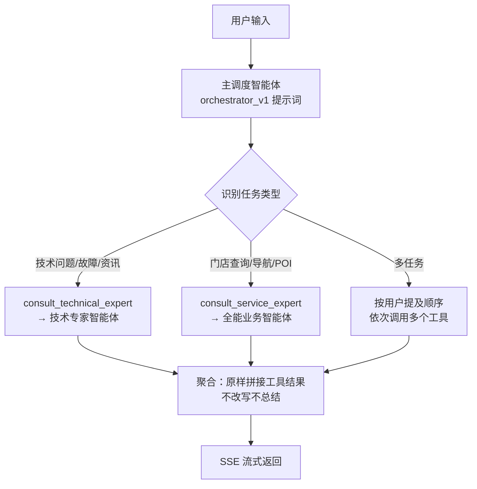

# ITS 多智能体 · 产品文档

> 版本：v1.1 ｜ 更新时间：2026-09-12 ｜ 配套：[readme](../readme.md) ｜ [开发文档](03-开发文档.md)

## 1. 产品定位

一句话：**面向电脑/数码用户的 7×24 智能售后客服**——用户用自然语言描述问题，系统自动判断意图并调度对应"专家"（知识库问答 / 门店查询 / 联网搜索 / 地图服务），流式给出可执行的解决方案。

**产品价值**：
- 对用户：不用查文档、不用排队等人工，一个问题直接得到步骤化答案 + 就近服务点
- 对企业：知识库资产化，人工客服压力下降，服务过程可沉淀（会话记忆）
- 对运营：知识库管理平台可上传/验证知识，形成"问题→知识"闭环

**产品边界（当前版本不做的事）**：
- 不做用户登录鉴权（user_id 由前端生成传入）
- 不做人工客服转接
- 不做多语言（中文为主）
- 不做主动营销/推送

## 2. 目标用户与用户故事

| # | 用户故事 | 验收标准 |
|---|---|---|
| US1 | 作为设备使用者，我想用口语描述故障（"开机没反应"），直接得到排查步骤 | 回答含编号步骤；基于知识库原文；附引用资料编号 |
| US2 | 作为异地用户，我想查询附近的维修点 | 返回门店列表（名称/地址）；能拉起地图导航 |
| US3 | 作为用户，一个提问里可以包含多个任务（"先帮我看看怎么修，修不了帮我找维修站"） | 调度器依次调用多个工具，结果按顺序拼接 |
| US4 | 作为用户，我希望得到实时资讯（股价/天气） | 联网搜索返回（依赖百炼 key） |
| US5 | 作为用户，关掉页面再回来，我能找回历史会话 | `/api/user_sessions` 返回全部历史 |
| US6 | 作为知识库运营者，我上传一篇 md 文档后立即可被检索到 | 上传响应返回 chunks_added；`/query` 能命中 |

## 3. 核心功能规格

### 3.1 智能对话（agent_web_ui → 主服务 :8000）

**输入**：自由文本（中文为主）
**输出**：SSE 流式事件，逐字渲染 Markdown；穿插"智能体工作过程卡片"

| 功能 | 处理逻辑 | 异常分支 | 状态 |
|---|---|---|---|
| 意图路由 | 主调度智能体按提示词分类：技术/资讯→技术专家；门店/导航→业务智能体 | 多任务依次全部调用；不主动加戏（任务完整性原则） | ✅ |
| 知识库问答 | 技术专家调用 `query_knowledge` 工具 → HTTP 调 8001 | 8001 不可达 → 工具返回 error dict → 智能体告知失败 | ✅ |
| 门店查询 | 业务智能体：文本解析位置 → 坐标检索 MySQL → 排序推荐 | MySQL 不可用 → 工具报错，回答降级说明 | ⚠️ 待建 its 库+repair_shops 表 |
| 地图服务 | 百度地图 MCP（SSE 传输，14 个工具：地理编码/逆编码/路线/天气/IP定位等） | MCP 连接失败仅记日志，对应工具不可用 | ✅ |
| 联网搜索 | 百炼 WebSearch MCP（**streamable-HTTP 传输，`/mcp` 端点**） | 账户欠费/key 无效 → 401/403，工具不可用（用 `mcp_check.py` 体检） | ✅ 需账户有余额 |
| 会话历史 | 每轮对话追加存储为 JSON 文件 | 目录不存在自动创建 | ✅ |
| 失败重试 | 链路抛异常时流内提示"自动重试"并重跑一次 | 仅重试一次（`flag=False` 防止无限递归） | ✅ |

### 3.2 知识库管理（knowlege_platform_ui :3000 → :8001）

| 功能 | 输入 | 输出 | 状态 |
|---|---|---|---|
| 文档上传 | md 文件（multipart） | `{status, message, file_name, chunks_added}` | ✅ |
| 检索验证 | 问题文本 | `{question, answer}`（含引用编号） | ✅ |

### 3.3 离线管线（CLI）

| 工具 | 触发时机 | 注意事项 |
|---|---|---|
| `crawl_cli.py` | 需要新知识时 | 真实外网请求 ×1000，已有 735 篇勿重复爬 |
| `upload_cli.py` | 新增文档增量入库 / 换 embedding 模型后全量重建 | 重复跑会产生重复向量，全量重建前先备份 chroma 目录 |

## 4. 意图路由决策流程

**调度原则（来自 `prompts/orchestrator_v1.md`）**：
- 任务完整性：用户明确提了几个任务就处理几个，不推测不加戏
- 结果聚合：多步骤任务收集每个工具的返回，按顺序拼接
- 原样输出：直接输出工具内容，不改写不润色

## 5. 依赖降级矩阵（哪个外部依赖挂了会怎样）

| 依赖 | 挂掉的表现 | 影响面 | 用户感知 |
|---|---|---|---|
| 硅基流动 LLM | 401/超时 | 全部对话不可用 | "❌ 系统错误"+自动重试一次 |
| 知识库服务 :8001 | 工具返回 error | 技术问答退化为"无法查询知识库" | 回答提示查询失败 |
| 百炼 key | WebSearch MCP 401 | 联网搜索不可用 | 实时类问题答不了 |
| 百度地图 MCP | 连接失败（启动时日志） | 导航/定位不可用 | 门店查询只剩文字列表 |
| MySQL | 连接拒绝 | 门店数据查不到 | 同上 |

> 设计启示：外部依赖故障半径被控制在"单个工具不可用"，主链路（路由+知识库问答）只要硅基流动和 8001 存活就可用。

## 6. 会话生命周期

## 7. 界面说明

**对话前端（agent_web_ui，5173）**
- 顶部：用户/会话标识；侧栏/下拉：历史会话列表（来自 `/api/user_sessions`）
- 主区：消息流；助手消息以 Markdown 渲染（marked），过程中的"工作卡片"（HTML 片段）展示调度与工具调用轨迹
- 输入区：文本框 + 发送；SSE 逐字上屏

**知识库前端（knowlege_platform_ui，3000）**
- 布局：左侧导航 + 内容区（vue-router）
- Knowledge 页：上传文档、查看入库结果
- Chat 页：知识库范围问答验证

## 8. 非功能性需求（当前实现水平）

| 维度 | 现状 | 备注 |
|---|---|---|
| 响应体验 | SSE 流式，首 token 秒级 | 取决于上游 LLM |
| 准确性 | 强制基于检索资料回答，未命中明确说"未找到" | 提示词约束防幻觉 |
| 成本控制 | temperature=0；子智能体 max_tokens=2048；检索只喂 Top2 文档 | 见开发文档 §7.4 |
| 会话持久化 | JSON 文件，单机 | 多实例需迁移存储 |
| 安全 | CORS `*` 全放开；密钥走 .env | 生产需收紧 |
| 可观测 | 日志落 `logs/`；Agents SDK tracing 已禁用 | 无 metrics |

## 9. 产品待办（Roadmap，2026-09-27 更新）

1. ~~修复百炼 key，恢复联网搜索~~ ✅（2026-09-19 充值生效，WebSearch/子模型 qwen3-max 全通）
2. **导入 `repair_shops` 门店数据**，打通门店查询闭环（MySQL 密码已修复，只差建库建表）
3. 知识库管理端补齐：文档列表/删除/重建、检索效果评估页
4. 会话记忆迁移 MySQL/Redis
5. 回答质量评估：引用命中率、检索相关性抽检
6. 用户登录与多租户隔离
7. 对话中的追问（当前上下文靠历史列表传入，长会话需做摘要压缩）
