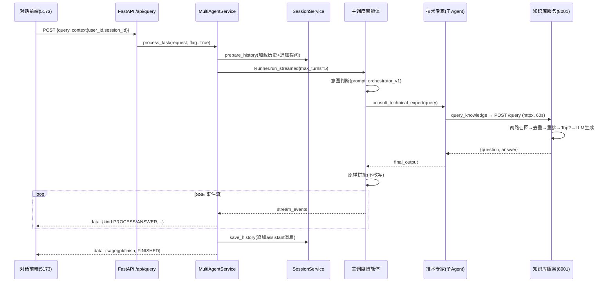
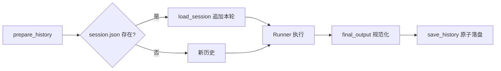
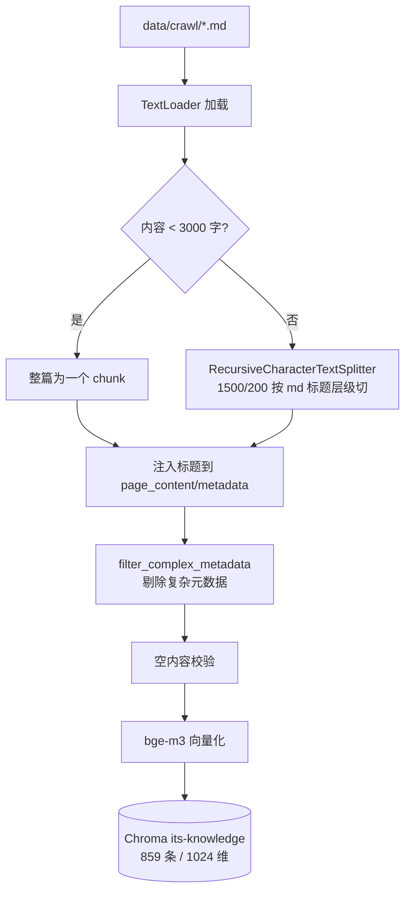
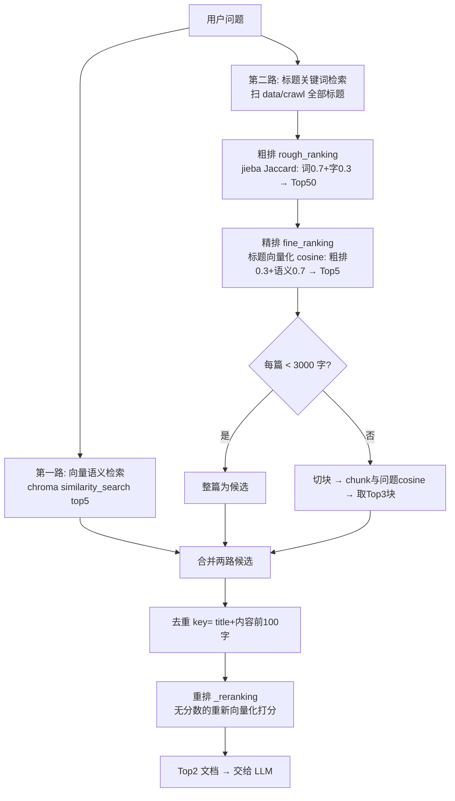

# ITS 多智能体 · 开发文档（代码详解版）

> 更新时间：2026-09-27 ｜ 所有结论均经本机实测验证，代码片段摘自仓库当前版本
> 配套：[readme](readme.md) ｜ [产品文档](02-产品文档.md) ｜ [学习文档](04-综合学习文档.md)

---

## 1. 环境要求与依赖

| 组件 | 要求 |
|---|---|
| Python | `D:\devEnv\12_anaconda`（3.10+） |
| Node.js | v18+（实测 v24.11.0） |
| MySQL | 本地 3306（仅门店查询工具需要，可选） |
| 外部服务 | 硅基流动 API（必需）、百度地图 MCP（推荐）、百炼 MCP（可选） |

### 版本红线 ⚠️（共享环境必读）

```bash
D:\devEnv\12_anaconda\python.exe -m pip install "openai-agents==0.20.0" "openai>=2.26,<3" pymysql DBUtils pystun3
```

- `openai` 锁 2.x：`langchain-openai 1.3.3` 要求 `openai>=2.26,<3`，升 3.x 打挂 knowledge 模块
- `openai-agents` 锁 0.20.0：0.21+ 要求 `openai>=3.0.0`（已实测验证 PyPI requires_dist）
- 环境里 `instructor` 要求 openai<2 的冲突是历史遗留，与本项目无关

---

## 2. 配置体系

### 2.1 配置加载优先级（pydantic-settings）

```
真实环境变量  >  .env 文件  >  字段默认值
```

⚠️ `knowledge/config/settings.py` 的字段默认值用 `os.environ.get()` 在**类定义时**求值：

```python
class Settings(BaseSettings):
    API_KEY: str = os.environ.get("API_KEY")   # 默认值在 import 时定格
    ...
    model_config = SettingsConfigDict(env_file=os.path.join(_project_root, ".env"))
```

所以**不要**在系统级设置 `BASE_URL`、`API_KEY` 这类通用名环境变量——环境变量优先级高于 .env，会静默覆盖配置（.env 里写什么都没用）。

### 2.2 backend/app/.env 全表

| 配置项 | 消费方 | 说明 | 当前状态 |
|---|---|---|---|
| `SF_API_KEY`/`SF_BASE_URL` | `openai_client.main_model_client` | 硅基流动 | ✅ |
| `MAIN_MODEL_NAME` | `main_model` | Qwen/Qwen3-32B | ✅ |
| `AL_BAILIAN_API_KEY/_BASE_URL`、`SUB_MODEL_NAME` | `sub_model_client`/`sub_model` | 百炼 `qwen3-max`（2026-09-19 账户充值后恢复） | ✅ |
| `DASHSCOPE_BASE_URL` | 搜索 MCP 地址 | ⚠️ **必须用 `/mcp`**（streamable-HTTP）；`/sse` 已被阿里云下线 | ✅ |
| `DASHSCOPE_API_KEY` | 搜索 MCP 鉴权（与子模型 key 解耦，`mcp_servers.py` 消费） | ✅ |
| `BAIDUMAP_AK` | 百度地图 MCP | ⚠️ 注意是百度 AK，别填成百炼 key（踩过） | ✅ |
| `MYSQL_*` | `database_pool` | 密码已修复可连通；`its` 库尚不存在，需建库+导 `repair_shops` | ⚠️ |
| `KNOWLEDGE_BASE_URL` | `knowledge_base.query_knowledge` | `http://127.0.0.1:8001` | ✅ |

> 克隆项目后：`cp .env.example .env` 填入真实值即可，三份模板分别在 `backend/app`、`backend/knowledge`、`backend/openai-agents-tutorial` 下。

### 2.3 backend/knowledge/.env

`API_KEY/BASE_URL`（硅基流动，LLM+Embedding 共用）、`MODEL=Qwen/Qwen3-32B`、`EMBEDDING_MODEL=BAAI/bge-m3`、`KNOWLEDGE_BASE_URL`（爬虫目标站 iknow.lenovo.com.cn）。

---

## 3. 运行方式与导入根

两个后端的导入都以**各自模块目录为根**。直接右键跑深层脚本会 `ModuleNotFoundError: No module named 'xxx'`，三种解法：

1. PyCharm：模块目录 Mark as **Sources Root**
2. 模块方式：`cd 对应目录 && python -m api.main`（CLI 同理 `python -m cli.upload_cli`）
3. 脚本自举（已加在 `crawler/client.py`、`cli/crawl_cli.py`、`cli/upload_cli.py` 头部）：

```python
import sys
from pathlib import Path
# N = 本文件距模块根的目录层数：client.py 在第3层用 parents[2]，cli 下第2层用 parents[1]
sys.path.insert(0, str(Path(__file__).resolve().parents[N]))
```

`test/` 下 `test_*.py` 会被 PyCharm 自动按 pytest 运行（Empty suite, exit 5）。可执行代码包进 `if __name__ == '__main__':`，用行号旁绿色三角运行；或改名 `demo_*`。

---

## 4. API 接口与 SSE 协议

### 4.1 主服务 :8000

**POST /api/query** —— 请求体：

```json
{"query": "电脑开机没反应怎么办",
 "context": {"user_id": "test_user", "session_id": "可选"},
 "flag": true}
```

**SSE 事件结构**（`data: {json}\n\n`，见 `utils/response_util.ResponseFactory`）：

```json
{"id": "uuid", "content": {"contentType": "sagegpt/text", "text": "...", "kind": "ANSWER|PROCESS"},
 "status": "IN_PROGRESS|FINISHED", "metadata": {"createTime": "...", "errorMessage": null}}
```

- `kind=PROCESS`：过程卡片（调度/工具调用轨迹，含 HTML 片段）、错误提示、重试提示
- `kind=ANSWER`：正文逐字片段
- 最后一条 `contentType: sagegpt/finish`、`status: FINISHED` 收尾

**POST /api/user_sessions**：`{"user_id": "..."}` → 全部会话 JSON。

### 4.2 知识库服务 :8001

| 方法 | 路径 | 请求 | 响应 |
|---|---|---|---|
| POST | `/upload` | multipart 文件 | `{status, message, file_name, chunks_added}` |
| POST | `/query` | `{"question": "..."}` | `{question, answer}` |

---

## 5. 主服务代码走读（backend/app）

### 5.1 启动与生命周期（api/main.py）

```python
@asynccontextmanager
async def lifespan(app: FastAPI):
    await mcp_connect()      # 启动：建立百度地图/搜索两个 MCP 长连接（失败只记日志不阻断）
    yield
    await mcp_cleanup()      # 关闭：清理连接

app = FastAPI(title="ITS API", lifespan=lifespan)
app.add_middleware(CORSMiddleware, allow_origins=["*"], ...)   # CORS 全开，生产需收紧
app.include_router(router=router)
uvicorn.run(app=create_fast_api(), host="127.0.0.1", port=8000)
```

MCP 连接放在 lifespan 而不是请求内，**复用长连接**避免每请求握手（SSE 握手成本高）。

### 5.2 LLM 客户端双通道（infrastructure/ai/openai_client.py）

```python
main_model_client = AsyncOpenAI(base_url=SF_BASE_URL, api_key=SF_API_KEY)          # 硅基流动
sub_model_client  = AsyncOpenAI(base_url=AL_BAILIAN_BASE_URL, api_key=AL_BAILIAN_API_KEY)  # 百炼(临时指向SF)

main_model = OpenAIChatCompletionsModel(model=MAIN_MODEL_NAME, openai_client=main_model_client)
sub_model  = OpenAIChatCompletionsModel(model=SUB_MODEL_NAME,  openai_client=sub_model_client)
```

> 注意：当前**三个智能体全部用 `sub_model`**（`orchestrator_agent.py:19` 的 `main_model` 被注释）。要升级调度模型，把 orchestrator 的 `model=` 改回 `main_model` 即可。

### 5.3 请求处理链路（api/routers.py → services/agent_service.py）

路由层极薄——拿上下文、起服务、包 SSE：

```python
@router.post("/api/query")
async def query(request_context: ChatMessageRequest) -> StreamingResponse:
    return StreamingResponse(
        content=MultiAgentService.process_task(request_context, flag=True),
        media_type="text/event-stream")
```

核心在 `MultiAgentService.process_task`（services/agent_service.py）：

```python
chat_history = session_service.prepare_history(user_id, session_id, user_query)  # ① 取历史+追加本轮

streaming_result = Runner.run_streamed(
    starting_agent=orchestrator_agent,
    input=chat_history,        # ② 完整历史作为输入（多轮上下文）
    context=user_query,
    max_turns=5,               # ③ COT 迭代上限：思考→行动(调工具)→观察 的轮数，不是重试次数
    run_config=RunConfig(tracing_disabled=True))

async for chunk in process_stream_response(streaming_result):   # ④ SDK事件 → SSE 格式转发
    yield chunk

agent_result = streaming_result.final_output                    # ⑤ 结束后取最终输出
chat_history.append({"role": "assistant", "content": re.sub(r'\n+', '\n', agent_result)})
session_service.save_history(user_id, session_id, chat_history) # ⑥ 持久化本轮
```

**异常重试**（同一个文件）：

```python
except Exception as e:
    yield "data: " + ResponseFactory.build_text(f"❌ 系统错误: {e}", ContentKind.PROCESS)...
    if flag:                       # flag=True 只允许重试一次，递归时传 False 防无限循环
        async for item in MultiAgentService.process_task(request, flag=False):
            yield item
```

### 5.4 智能体编排（multi_agent/，Agent-as-Tool 模式）

**调度者**（orchestrator_agent.py）：

```python
orchestrator_agent = Agent(
    name="主调度智能体",
    instructions=load_prompt("orchestrator_v1"),   # 提示词外置 markdown
    model=sub_model,                                # main_model 被注释
    model_settings=ModelSettings(temperature=0),
    tools=AGENT_TOOLS,                              # 子智能体包装成的工具
)
```

**把子智能体包装成工具**（agent_factory.py）——这是本项目的核心编排模式：

```python
@function_tool
async def consult_technical_expert(query: str) -> str:
    """【咨询与技术专家】处理技术咨询、设备故障、维修建议以及实时资讯…
    （docstring 就是给调度模型看的工具说明书，路由准确率取决于它写得清不清楚）"""
    result = await Runner.run(technical_agent, input=query,
                              run_config=RunConfig(tracing_disabled=True))
    return result.final_output      # 子智能体的最终回答作为工具返回值
```

**两个子智能体**：

| 智能体 | 模型 | 本地工具 | 远程 MCP |
|---|---|---|---|
| `technical_agent`（资讯与技术专家） | sub_model, temp=0 | `query_knowledge` | 搜索 MCP |
| `comprehensive_service_agent`（全能业务） | sub_model, temp=0, **max_tokens=2048** | `resolve_user_location_from_text`、`query_nearest_repair_shops_by_coords` | 百度地图 MCP |

**Agent-as-Tool vs Handoff**：本项目用前者——调度者始终在环，拿到子结果后聚合输出（提示词要求"原样拼接"）；Handoff 则是把控制权完全移交。多轮复杂对话可对比两种模式。

**跨服务工具**（infrastructure/tools/local/knowledge_base.py）：

```python
@function_tool
async def query_knowledge(question: str) -> Dict:
    async with httpx.AsyncClient(trust_env=False) as client:
        response = await client.post(f"{settings.KNOWLEDGE_BASE_URL}/query",
                                     json={"question": question}, timeout=60)
        response.raise_for_status()
        return response.json()      # {"question": ..., "answer": ...}
```

> `trust_env=False`：忽略系统代理环境变量，避免本地代理劫持内网请求——工程上容易踩的坑。

### 5.5 端到端时序图（一次技术类提问的完整生命周期）



### 5.6 会话记忆（repositories/session_repository.py）

- 存储：`backend/app/user_memories/<user_id>/<session_id>.json`，**与 MySQL 无关**
- 读取：`get_all_sessions_metadata` 遍历用户目录 `*.json`，返回 `(session_id, 创建时间, 内容)`；损坏文件捕获异常继续，不阻断列表
- 写入：懒创建目录；`json.dump(ensure_ascii=False, indent=2)`
- 单例：模块级 `session_repository = SessionRepository()`



### 5.7 MCP 接入（infrastructure/tools/mcp/mcp_servers.py）

**两种传输协议并存（2026-09-19 定稿）**：

```python
from agents.mcp import MCPServerSse, MCPServerStreamableHttp

# 百炼 WebSearch：/mcp 端点 = streamable-HTTP 传输（阿里云已下线 /sse）
search_mcp_client = MCPServerStreamableHttp(
    name="通用联网搜索",
    params={"url": f"{settings.DASHSCOPE_BASE_URL}",      # .../WebSearch/mcp
            "headers": {"Authorization": f"Bearer {settings.DASHSCOPE_API_KEY}"},
            "timeout": 60, "sse_read_timeout": 60*30},
    client_session_timeout_seconds=60*10,
    cache_tools_list=True)

# 百度地图：/sse 端点 = SSE 传输（仍正常）
baidu_mcp_client = MCPServerSse(
    name="百度地图",
    params={"url": f"https://mcp.map.baidu.com/sse?ak={settings.BAIDUMAP_AK}",
            "timeout": 60, "sse_read_timeout": 60*30},
    client_session_timeout_seconds=60*10,
    cache_tools_list=True)
```

| 教训 | 说明 |
|---|---|
| 端点路径 ≠ 传输协议 | `/mcp` 是 streamable-HTTP，`MCPServerSse` 连它必失败；反之亦然。判别方法：`curl` POST 一个 initialize JSON-RPC，返回 `BaiLianMcpServer` 即 streamable |
| key 解耦 | 搜索 MCP 用 `DASHSCOPE_API_KEY`（独立），子模型用 `AL_BAILIAN_API_KEY`——子模型借道其他服务商时搜索不受影响 |
| MCP 挂载守则 | MCP 不可用时必须从 Agent 的 `mcp_servers` 摘除，否则该 Agent 每次 run 必失败（`Server not initialized`），调度器会循环重试耗尽 max_turns（故障 #8） |

**调试工具**：
- `mcp_check.py [search|baidu|all]` —— 连通性三步体检（连接→列工具→调用），失败时给出修复建议（401→key 问题、403/Arrearage→欠费）
- `python mcp_servers.py [search|baidu|all]` —— 打印每个工具的参数 Schema 并真实调用（接新 MCP 先跑它）；调试函数已改名 `debug_*` 避免被 pytest 收集

### 5.8 MySQL 连接池（infrastructure/database/database_pool.py）

```python
pool = DatabasePool.get_pool()   # import 时即创建 PooledDB 单例
# mincached=0：惰性连接，import 不会真连 MySQL —— 所以 MySQL 没起应用也能启动
```

> 注意 `PooledDB` 未显式设置 `ping`，长时间空闲连接可能失效；生产建议 `ping=1`。门店查询 SQL 在 `infrastructure/tools/local/service_station.py:236`（`FROM repair_shops`）。

---

## 6. 知识库服务代码走读（backend/knowledge）

### 6.1 爬虫管线

```
crawl_cli.py（for 1..1000, sleep 0.05）
  → KnowledgeApiClient.fetch_knowledge_content(no)     # GET /knowledgeapi/api/knowledge/knowledgeDetails?knowledgeNo=x
  → HtmlParser                                          # 解析 data 字段 HTML
  → TextUtils / markdownify                             # HTML → Markdown
  → data/crawl/{序号}-{标题}.md                          # 735 篇已就位
```

### 6.2 入库管线（services/ingestion/ingestion_processor.py）

```python
self.document_spliter = RecursiveCharacterTextSplitter(
    chunk_size=1500, chunk_overlap=200,     # ⚠️ 实际切分是 1500/200；settings.CHUNK_SIZE=3000
    separators=["\n## ", "\n**"             #    只用作"是否切分"的阈值（见下）
               "\n\n", "\n", " ", ""])       # ⚠️ 注意 "\n**" 后缺逗号，实际成 "\n**\n\n" 一个分隔符
```

**动态切分策略**（ingest_file）：

```python
for doc in documents:
    doc.metadata['title'] = MarkDownUtils.extract_title(md_path)   # 每篇注入标题元数据

if len(doc.page_content) < 3000:      # 短文档：整篇作为一个 chunk（语义不丢）
    final_document_chunks.append(doc)
else:                                  # 长文档：切块 + 每块注入标题做背景
    for chunk in self.document_spliter.split_documents(documents):
        title = os.path.basename(chunk.metadata['source'])
        chunk.page_content = f"文档来源:{title}\n{chunk.page_content}"
        ...

clean = filter_complex_metadata(final_document_chunks)   # 过滤 Chroma 不支持的元数据类型
valid = [d for d in clean if d.page_content.strip()]     # 空内容校验
self.vector_store.add_documents(valid)
```



> 设计思想（源码注释里有）：**小块嵌入、大块管理**——小块向量语义不稀释（召回准），标题注入让块保留业务背景（父文档思想）。

### 6.3 向量库仓储（repositories/vector_store_repository.py）

```python
self.embedding = OpenAIEmbeddings(            # 已修复：原硬编码第三方代理+失效key
    model=settings.EMBEDDING_MODEL,           # BAAI/bge-m3 → 1024 维
    openai_api_key=settings.API_KEY,
    openai_api_base=settings.BASE_URL)
self.vector_database = Chroma(persist_directory=settings.VECTOR_STORE_PATH,
                              collection_name="its-knowledge", embedding_function=self.embedding)

def add_documents(self, documents, batch_size=16):
    for i in range(0, len(documents), batch_size):    # 分批入库+进度日志
        ...                                            # return 已移出循环（修复过提前返回 bug）
```

**换 embedding 模型 = 必须重建库**（维度/语义空间都变了）：备份旧目录 → 跑 `python -m cli.upload_cli`。Chroma 的 `similarity_search_with_score` 返回 **L2 距离**（越小越相似），本项目没用这个分数（见下，统一用余弦重打分）。

### 6.4 检索管线（services/retrieval_service.py）——全项目含金量最高的文件

**总控 `retrieval()`：两路召回 → 去重 → 重排 → Top2**



**粗排打分**（不走向量，纯词面，快）：

```python
char_score = |问∩题| / |问∪题|                       # 字符级 Jaccard
word_score = |jieba(问)∩jieba(题)| / |jieba(问)∪jieba(题)|   # 词级 Jaccard
roughing_score = word_score*0.7 + char_score*0.3     # 词级权重更高
# 全部标题排序取 Top50
```

**精排打分**（对 Top50 的标题向量化，与问题算余弦）：

```python
final_score = roughing_score*0.3 + cosine_sim*0.7    # 语义权重更高，粗排分做保底
# 排序取 Top5 标题 → 读文件 → 短文整篇 / 长文切块取Top3（块内容注入"文档来源:标题"）
```

**去重**：`key = (title, 清洗后内容前100字符)`，set 过滤两路召回的重复。

**重排 `_reranking`**：
- 第二路长文档的块已有 `similarity` 元数据 → 直接用
- 其余候选（第一路 chunk + 各路短文档）**批量重新向量化**算余弦（前缀拼 `文档来源:标题` 再嵌入）
- 最终 **只返回 Top2** 给生成服务——控制 prompt 长度与成本

> 与 settings 的差异：`TOP_ROUGH=50/TOP_FINAL=5` 在代码里是硬编码切片（`[:50]`/`[:5]`），settings 值仅供阅读参考；调整时改代码切片。

### 6.5 生成服务（services/query_service.py）

```python
self.llm = ChatOpenAI(model_name=settings.MODEL, openai_api_key=settings.API_KEY,
                      openai_api_base=settings.BASE_URL, temperature=0)  # temperature=0 抑制发挥
```

提示词四条硬约束（全文见代码）：①严格基于【参考资料】回答，未提及的信息禁止编造，无法回答时输出固定话术；②**去特定化**——除非用户点名型号/品牌，回答中移除"联想/K900"等（让答案泛化复用）；③操作步骤用有序列表；④结尾列出引用的资料编号。

---

## 7. 前端对接要点

**对话前端消费 SSE**（agent_web_ui/src/App.vue）：

```javascript
const response = await fetch('http://127.0.0.1:8000/api/query', {method:'POST', body:...});
const reader = response.body.getReader();
let buffer = '';
while (true) {
  const {done, value} = await reader.read();
  buffer += new TextDecoder().decode(value, {stream: true});
  const lines = buffer.split('\n');          // 按行切，最后一段可能是半包
  // 处理 lines[0..n-2]（完整行），buffer 保留最后一行等下一个 chunk
}
```

> 经典"半包处理"：TCP 分包不按行对齐，必须缓冲不完整的最后一行。改端口时注意 App.vue 里 **硬编码的 8000**；知识库前端走 vite 代理（`vite.config.js`：`/api` → `127.0.0.1:8001`，并 rewrite 去掉前缀）。

---

## 8. 测试与调试

```bash
# SSE 观察（-N 关闭缓冲，能看到逐条事件）
curl -N -X POST http://127.0.0.1:8000/api/query -H "Content-Type: application/json" \
  -d '{"query":"电脑开机之后无任何反应怎么办","context":{"user_id":"test_user"},"flag":true}'

# 知识库直测
curl -X POST http://127.0.0.1:8001/query -H "Content-Type: application/json" \
  -d '{"question":"电脑开机之后无任何反应怎么办"}'

# 检索层单测（不起服务，直接验证召回质量）
cd backend/knowledge && python -c "from services.retrieval_service import RetrievalService; \
  print([d.metadata['title'] for d in RetrievalService().retrieval('电脑开机无反应')])"

# MCP 工具探索
python -m infrastructure.tools.mcp.mcp_servers   # list_tools 打印每个工具的 inputSchema
```

日志：主服务落 `backend/app/logs/`；导入验证用 `python -c "import api.main"`（不触发 uvicorn）。

---

## 9. 已修复问题记录（回归检查清单）

| # | 问题 | 根因 | 修复 | 位置 |
|---|---|---|---|---|
| 1 | `/query` 全部 500（embeddings 401） | embedding 的 key/base_url/model 硬编码到失效的第三方代理 | 改读 settings | `vector_store_repository.py` |
| 2 | 入库只进首批 chunk | `add_documents` 的 return 写在 for 循环内 | return 移出循环 | 同上 |
| 3 | 装包破坏共享环境 | openai-agents 最新版强制 openai>=3 | 锁 `openai-agents==0.20.0` + `openai<3` | pip |
| 4 | 深层脚本直跑 ModuleNotFoundError | sys.path 只有脚本目录 | Sources Root / -m / 头部自举 | 3 个脚本 |
| 5 | dotenv 识别注释失败 | `.env` 用 `;` 注释 | 改 `#` | `knowledge/.env` |
| 6 | 子模型/搜索 MCP 401 | 百炼 key 失效 | 子模型临时指向硅基流动；搜索等新 key | `app/.env` |
| 7 | 门店查询 Access denied | `.env` MySQL 密码不对 | 待改真实密码+导入 repair_shops | `app/.env` |
| 8 | 部分问题流式无收尾、`Max turns (5) exceeded` | 百炼 key 失效→搜索 MCP 未 connect，technical_agent 每次构建工具列表抛 `Server not initialized`，调度器循环重试耗尽轮次 | 暂时摘除 technical_agent 的 search MCP（注释保留，key 修复后恢复） | `multi_agent/technical_agent.py` |
| 9 | 向量库 HNSW 索引损坏（新进程读库报 `Error loading hnsw index`） | chroma 进程被强杀时正在后台 compaction/落盘，segment 只剩 pickle 无二进制 | 隔离损坏目录并重建（停服务务必 CTRL+C 优雅退出） | `chroma_kb1/` |
| 10 | 直调工具报 `'FunctionTool' object is not callable` | `@function_tool` 把函数变成 FunctionTool 对象（由 SDK Runner 以 JSON 参数调度），不能再当普通函数调用 | 业务逻辑抽到 `*_impl` 普通函数，`@function_tool` 只做薄委托（docstring 保留在包装器上）；测试调 `*_impl` | `multi_agent/agent_factory.py` |
| 11 | 百炼 WebSearch MCP 打不通（充值后仍 401/超时） | ① 阿里云已下线 `/sse` 接入，新端点 `/mcp` 是 streamable-HTTP 传输；② 新端点曾只写在 .env 注释行 | 搜索 MCP 改用 `MCPServerStreamableHttp`；`.env` 生效行切到 `/mcp` | `mcp_servers.py`、`app/.env` |
| 12 | 仓库扫描出 4 个密钥、36 处硬编码（含**当前有效的硅基流动 key**） | 课程代码习惯把 key 写死在脚本里 | 27 个 .py 全部改为 `os.getenv("OPENAI_API_KEY")`；`settings.py` 的 key 默认值改 None；建 `.gitignore` + 3 份 `.env.example`；⚠️ 曾泄漏过的 key 建议在服务商控制台轮换 | 全局 |

## 10. FAQ

- **启动时"搜索MCP连接失败 401"？** 百炼 key 无效。⚠️ 注意：该 MCP 若仍挂在 technical_agent 上会导致其每次运行必失败（见故障记录 #8），现已摘除；key 修复后恢复 `mcp_servers=[search_mcp_client]` 即可。
- **知识库回答"未找到"？** 先跑检索层单测（§8）确认召回；召回正常而回答差 → 查 LLM 服务与提示词。
- **重复跑 upload_cli？** 向量重复堆积（检索出重复结果）。增量入库才跑它；全量重建先备份 `chroma_kb1`。
- **改了 EMBEDDING_MODEL 直接重启行吗？** 不行，维度不匹配直接报错，必须重建库。
- **前端连不上？** 对话前端硬编码 `127.0.0.1:8000`；知识库前端依赖 vite 代理，改后端端口要同步 `vite.config.js`。

## 11. 关键参数速查

| 参数 | 值 | 位置 |
|---|---|---|
| 入库切分 | 1500/200（<3000 字不切） | `ingestion_processor.py` |
| 粗排 TopN | 50 | `retrieval_service.rough_ranking` |
| 精排 TopN | 5（每篇长文取 Top3 块） | `fine_ranking`/`_deal_long_title_content` |
| 最终送 LLM 文档数 | **2** | `_reranking` |
| Agent 最大轮次 | max_turns=5 | `agent_service.py` |
| 知识工具超时 | 60s | `knowledge_base.py` |
| 失败重试 | 1 次 | `agent_service.py`（flag 递归控制） |
| 业务子模型上限 | max_tokens=2048 | `service_agent.py` |

## 12. 版本管理与密钥红线（2026-09-27 git 化）

### 12.1 仓库忽略策略（.gitignore）

| 忽略项 | 理由 |
|---|---|
| `**/.env` | 全部真实密钥（三处：app / knowledge / tutorial） |
| `backend/knowledge/chroma_kb1*/` | 向量库含备份/损坏副本，可由 `python -m cli.upload_cli` 重建 |
| `backend/knowledge/data/` | 爬取文档，可由 `python -m cli.crawl_cli` 重建 |
| `backend/app/logs/`、`backend/app/user_memories/` | 运行日志与用户会话数据 |
| `node_modules/`、`__pycache__/`、`*.egg-info/`、`.idea/` | 依赖缓存与 IDE |

### 12.2 密钥红线（提交前自检）

1. **任何密钥不进 Git**：`sk-` 开头的 key、百度 AK、数据库密码只允许存在于被 ignore 的 `.env`
2. **提交前扫描**：`grep -rE "sk-[A-Za-z0-9]{16,}" --include="*.py" .` 必须为 0（本仓库 2026-09-27 清理后归零）
3. **曾泄漏的 key 要轮换**：历史上硬编码过的 key（即使已失效）说明习惯有问题；**当前有效的 key 若曾出现在会泄漏的介质上，去服务商控制台轮换**
4. **模板化**：新配置项先加进 `.env.example`（占位值），再在 `.env` 填真实值
5. **`git status` 目检**：首次提交前确认 staged 列表无 `.env`、无向量库、无 node_modules

### 12.3 推送远端

```bash
git remote add origin <你的仓库URL>   # 建议 GitHub 私有仓库 或 Gitee
git push -u origin master
```

> 若仓库曾意外提交过密钥，单纯删除文件不够——历史提交里仍有，需要轮换 key 或用 `git filter-repo` 清史。本项目初始化时已清理干净，无此风险。
