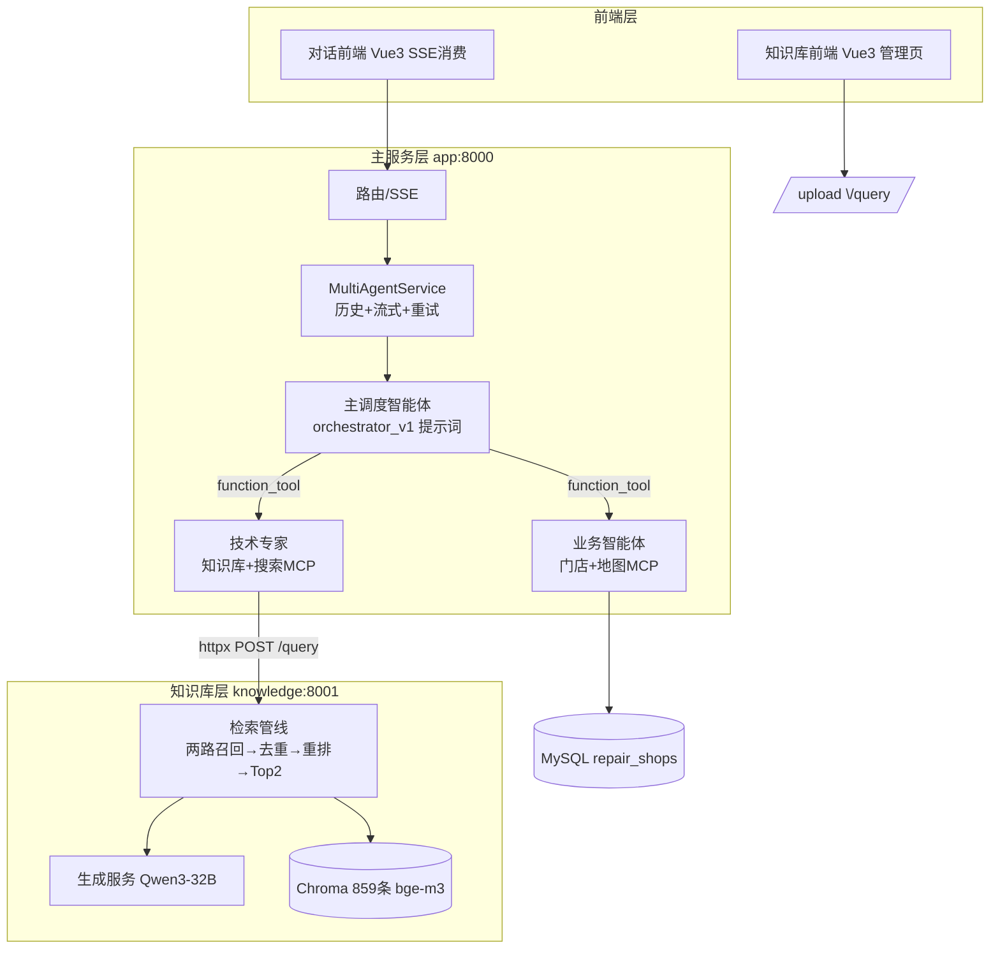
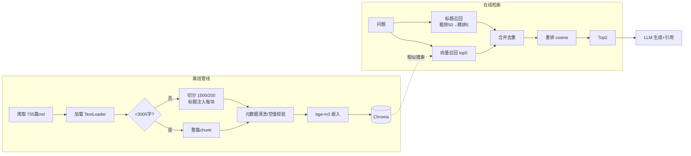

# ITS 多智能体 · 综合学习文档

> 写给要吃透这个项目的学习者：每个知识点都锚定**本项目里的具体代码**，配合开发文档（[03](03-开发文档.md)）的代码走读一起看。

## 1. 学习路线图（4 周）

```
第1周  FastAPI + SSE + 配置管理      → 目标：能独立改出一个新接口
第2周  RAG 全链路（knowledge 模块）   → 目标：能解释每一步为什么这么做、改参数看效果
第3周  Agents SDK 多智能体（app 模块）→ 目标：能新写一个子智能体并挂进调度
第4周  MCP + 前端联调 + 工程化       → 目标：端到端贯通 + 知道边界在哪
```

## 2. 全局认知：一张图看懂项目



## 3. 知识点 → 代码映射（第 1 周：FastAPI/SSE/配置）

| 知识点 | 代码位置 | 读什么 |
|---|---|---|
| 应用工厂 + lifespan | `app/api/main.py` | MCP 长连接为何放生命周期而不是请求内 |
| StreamingResponse | `app/api/routers.py` | 路由层怎么"薄"：只做请求→生成器→SSE 包装 |
| SSE 协议格式 | `utils/response_util.py` | `data: {json}\n\n`、kind/status 字段设计 |
| AsyncGenerator 流式转发 | `services/agent_service.py` | `async for ... yield` 链式传递 |
| pydantic-settings | 两个 `config/settings.py` | 配置优先级：环境变量 > .env > 默认值 |
| Pydantic 请求模型 + 校验 | `app/schemas/request.py` | 嵌套模型（UserContext） |

**练习 1（验收：curl 能看到逐条 SSE）**：仿写一个 `/api/echo` 接口，把输入文本按字流式返回。
**练习 2**：故意把 `KNOWLEDGE_BASE_URL` 改错，观察工具报错如何透传到前端卡片。

## 4. 知识点 → 代码映射（第 2 周：RAG 全链路 ⭐）

### 4.1 数据流总览



### 4.2 每一环的"为什么"（面试级追问自测）

| 环节 | 设计 | 为什么要这样（源码注释/实测） |
|---|---|---|
| 切分阈值 | <3000 字整篇不切 | 短文档切块反而丢语义；长文档才需要控制 token 与噪音 |
| 标题注入 | `文档来源:标题\n+内容` | 块脱离原文后仍有业务背景；嵌入时标题提供语义锚点 |
| 小块嵌入大块管理 | 粗排/精排都先比**标题** | 标题短、语义浓缩，嵌入不稀释；正文按需读取（父文档思想） |
| 双路召回 | 向量 + jieba 标题词面 | 向量管语义泛化（"无法开机"≈"启动失败"），词面管精确命中（型号词） |
| 两级加权 | 粗排 词0.7+字0.3；精排 粗0.3+语义0.7 | 先便宜后贵：词面过滤快，语义打分准，各司其职 |
| 去重 key | (title, 内容前100字) | 同一篇文档两路都召回时只留一份 |
| 重排只取 Top2 | 控制 prompt 长度 | 上下文越长越贵且越稀释；2 篇高质量 > 10 篇平庸 |
| temperature=0 | 生成与全部智能体 | 售后场景要稳定，不要创造性 |

### 4.3 动手实验（每个都有验收标准）

1. **参数敏感性**：`_reranking` 返回 `[:2]` 改成 `[:5]`，对 5 个测试问题对比回答质量与耗时
2. **召回消融**：注释掉第二路（`_search_based_title`），看型号类问题（如 "G480 数字键盘"）召回是否退化
3. **切分实验**：把 `chunk_size` 1500 改 500 重建一个小库，对比长文档问题的回答完整度
4. **嵌入一致性**：换 `EMBEDDING_MODEL` 不重建库直接查询，观察报错 → 理解"向量空间一致性"

### 4.4 本项目 RAG 的已知局限（进阶切入点）

- 无 rerank 专用模型（用 cosine 代替，可换 bge-reranker）
- `_deal_long_title_content` 的 metadata 键名有笔误（`"chunk_index:"` 多了冒号）——判断长块时用的是 `"chunk_index" in metadata`，能工作但脆弱
- `retrieval_service._search_based_title` 读文件失败时 `return []` 会丢掉整路结果（应 continue）
- 向量库无增量去重（重复 upload 会堆积）

## 5. 知识点 → 代码映射（第 3 周：Agents SDK ⭐）

### 5.1 智能体调用树

```mermaid
flowchart TD
    U[用户输入] --> ORCH[主调度智能体<br/>model=sub_model temp=0<br/>prompt=orchestrator_v1]
    ORCH -->|@function_tool<br/>consult_technical_expert| TA[技术专家智能体<br/>tools=query_knowledge<br/>mcp=搜索]
    ORCH -->|@function_tool<br/>consult_service_expert| SA[全能业务智能体<br/>tools=位置解析+门店查询<br/>mcp=百度地图 max_tokens=2048]
    TA --> KB[(知识库服务 8001)]
    SA --> MYSQL[(MySQL)]
    SA --> BAIDU[百度地图 MCP]
    TA --> SEARCH[百炼搜索 MCP]
```

### 5.2 核心概念对照

| SDK 概念 | 项目用法 | 代码 |
|---|---|---|
| `Agent` | 三个角色的定义；`instructions` 外置 markdown | `multi_agent/*.py` + `prompts/` |
| `@function_tool` | 两个子智能体包成工具（docstring=给调度模型的说明书）；`query_knowledge` 跨服务工具 | `agent_factory.py`、`knowledge_base.py` |
| Agent-as-Tool | 调度者在环、聚合结果（prompt 要求"原样拼接"） | 对比 tutorial 的 Handoff 写法 |
| `Runner.run_streamed` | 事件流逐个转 SSE；`max_turns=5` 是 COT 轮数上限 | `agent_service.py` |
| `RunConfig(tracing_disabled=True)` | 不上报 OpenAI tracing | 各 Runner 调用处 |
| `ModelSettings` | temperature=0；业务智能体 max_tokens=2048 控成本 | `service_agent.py` |
| 异常与重试 | 流内 yield 错误卡片 + flag 递归只重试一次 | `agent_service.py` except 分支 |

**练习 3（验收：新智能体被正确路由）**：写一个"闲聊智能体"（不挂任何工具，prompt 定义人设），包成 `@function_tool` 挂进 AGENT_TOOLS，测试"你好"类问题路由过去、技术问题不受影响。
**练习 4**：把 orchestrator 的 `model=` 从 `sub_model` 换成 `main_model`，构造 10 个混合意图问题，统计路由准确率差异。

## 6. 知识点 → 代码映射（第 4 周：MCP/前端/工程化）

| 知识点 | 代码位置 | 要点 |
|---|---|---|
| MCPServerSse | `infrastructure/tools/mcp/mcp_servers.py` | 双超时设计（建连短/读长）、`cache_tools_list` |
| MCP 生命周期 | `mcp_manager.py` + `api/main.py` lifespan | 启动连接/关闭清理；连接失败不阻断 |
| MCP 调试 | 同文件 `run_mcp_call` | 先 list_tools 看 inputSchema 再调用 |
| SSE 前端消费 | `agent_web_ui/src/App.vue` | fetch+ReadableStream、**半包缓冲**处理 |
| vite 代理 | `knowlege_platform_ui/vite.config.js` | `/api` → 8001 并 rewrite 去前缀 |
| 连接池 | `infrastructure/database/database_pool.py` | PooledDB 单例、惰性连接（mincached=0） |
| 文件型存储 | `repositories/session_repository.py` | 目录+JSON、懒创建、损坏文件容错 |

## 7. 本项目里真实踩过的坑（工程素养课）

| # | 坑 | 教训 |
|---|---|---|
| 1 | 深层脚本直跑 `ModuleNotFoundError` | sys.path 只含脚本目录；导入根要显式建立（Sources Root / -m / 自举） |
| 2 | embedding key/URL 硬编码 → 500 | 外部依赖一律走配置；密钥永不入库 |
| 3 | pip 装最新版打挂共享环境 | 装包先查 requires_dist；共享环境锁版本 |
| 4 | `add_documents` return 在循环内，静默丢数据 | ETL 必须对账（入库数 vs 源数）；"不报错"≠"正确" |
| 5 | `test_*.py` 被 pytest 劫持（Empty suite） | 命名即契约；可执行代码进 `__main__` 保护 |
| 6 | 百炼 key 失效 | 外部依赖故障半径设计：单工具挂≠全站挂 |
| 7 | settings 与代码硬编码不一致（3000 vs 1500/50/5/2） | 配置项要么生效要么删掉，避免"看起来可配其实写死" |
| 8 | `.env` 用 `;` 注释不识别 | dotenv 注释用 `#` |
| 9 | `await query_xxx(query=...)` 报 `'FunctionTool' object is not callable` | `@function_tool` 产物只能由 SDK Runner 调度；测试走 `*_impl` 普通函数（impl 分离模式），docstring 留在包装器上 |
| 10 | MCP 充值后仍连不上 | 端点路径 ≠ 传输协议：`/sse`（SSE）与 `/mcp`（streamable-HTTP）客户端不通用；先 `curl` POST initialize 判协议，再选 `MCPServerSse` / `MCPServerStreamableHttp` |
| 11 | 新配置只写进了 `.env` 注释行，生效行还是旧值 | pydantic-settings 只读生效行；改配置后 `python -c "from config.settings import settings; print(...)"` 验证真实值 |
| 12 | 同一坐标在不同地图偏几百米 | 百度 bd09ll ≠ 高德 GCJ-02 ≠ GPS WGS84；跨平台先转坐标（`map_geoconv`） |

## 8. 进阶方向

- **检索升级**（作者自己在 `knowledge/说明.txt` 列的 TODO）：多路召回融合、bge-reranker 排序模型、动态阈值 TopN、md 图片多模态
- **编排升级**：Agent-as-Tool ↔ Handoff 对比实验；调度模型升级（main_model）与路由准确率评测
- **工程化**：会话迁 Redis/MySQL、Docker Compose 一键全栈、引用命中率评测集、pytest 真单测（检索层最值得测）
- **数据视角**：把入库管线当成 mini 数据管道做监控——文档数/chunk 数/嵌入失败数每日对账

## 9. 一页速记

- 启动顺序 8001 → 8000；两个后端各自为导入根
- 编排 = Agent-as-Tool；调度原则 = 任务完整性 + 原样聚合
- RAG = 双路召回（向量+标题）→ 50 → 5 → 去重重排 → **Top2** → 强制引用生成
- 入库 = 短文整篇、长文 1500/200 切 + 标题注入
- 版本红线 = openai 2.x + openai-agents 0.20.0
- 温度全 0；业务子模型 max_tokens=2048；失败只重试 1 次
- 一切密钥进 .env；外部依赖可降级
