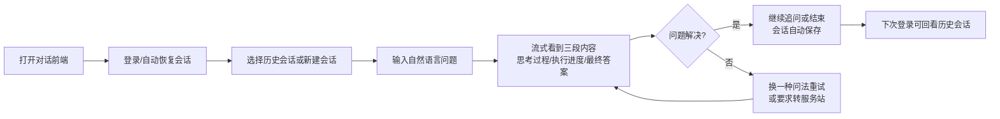
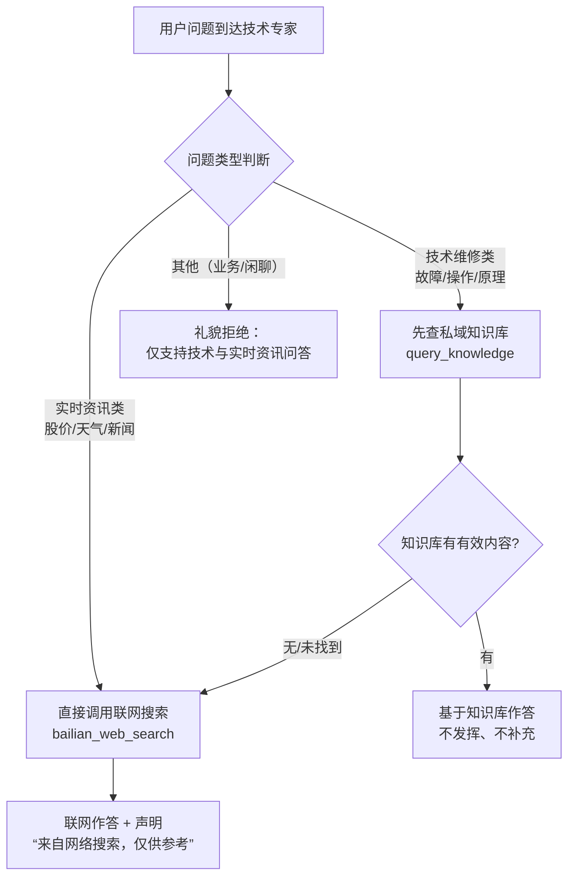
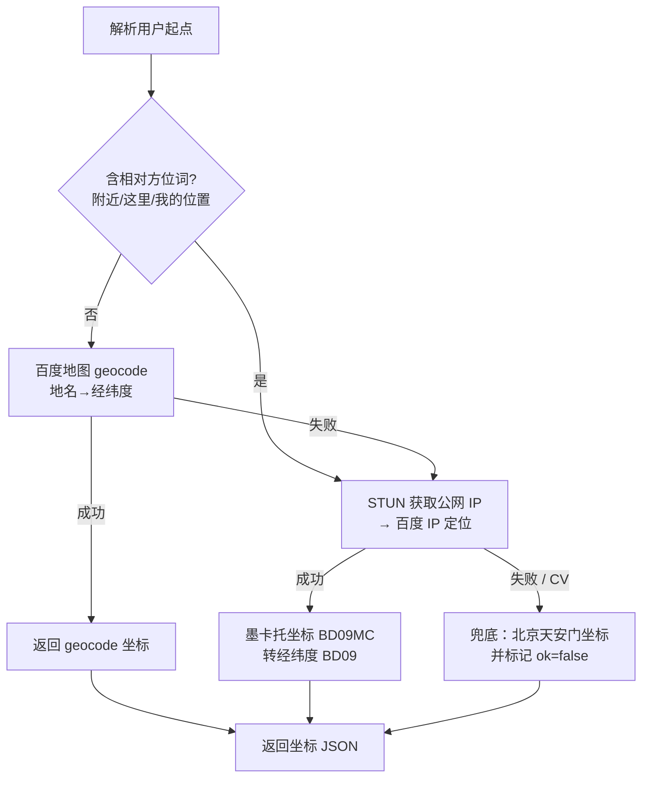
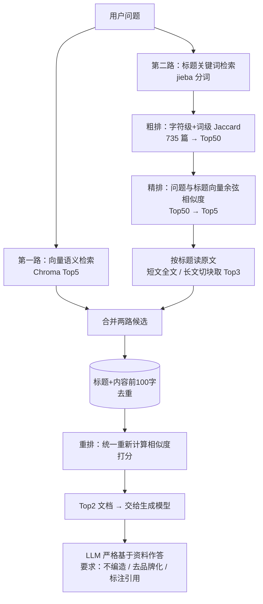
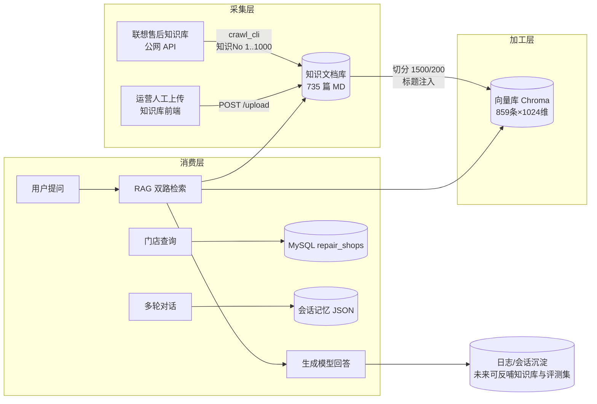
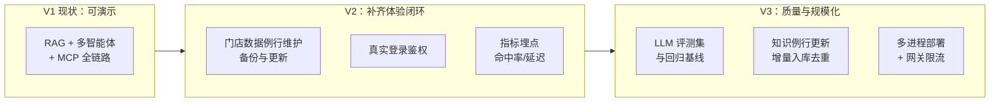

# 1_产品文档（ITS 智能技术支持多智能体系统）

> 编写视角：资深数据产品工程师
> 更新时间：2026-11-04
> 适用版本：基于仓库 `its_multi_agent` 当前主干代码（cf0bcb1）整理
> 读者对象：产品经理、数据产品经理、运营人员、项目干系人

---

## 目录

1. [产品概述](#1-产品概述)
2. [用户与场景](#2-用户与场景)
3. [核心业务流程](#3-核心业务流程)
4. [功能清单](#4-功能清单)
5. [数据资产全景（数据产品视角）](#5-数据资产全景数据产品视角)
6. [用户故事与验收标准](#6-用户故事与验收标准)
7. [非功能需求现状](#7-非功能需求现状)
8. [产品指标体系建议](#8-产品指标体系建议)
9. [产品现状、风险与路线图](#9-产品现状风险与路线图)

---

## 1. 产品概述

### 1.1 一句话定位

**ITS（Intelligent Technical Support）多智能体** 是一个基于大语言模型（LLM）的智能技术支持 / 售后客服系统：用户用自然语言提出问题，系统自动识别意图，把任务分派给最合适的专业智能体（技术答疑 / 门店导航 / 实时资讯），并以打字机式的流式体验实时返回答案。

### 1.2 产品模式：模拟真实企业的"客服调度台"

传统客服系统要么是"一问一答的知识库机器人"（能力单一），要么是"一个大模型硬答所有问题"（容易幻觉）。ITS 采用**主调度 + 专家分工**的多智能体（Multi-Agent）模式：

| 角色 | 系统内名称 | 职责 | 能力来源 |
|---|---|---|---|
| 客服调度台 | 主调度智能体（Orchestrator） | 理解用户消息里包含几个任务、分别是什么类型，转派给正确的专家，并聚合结果 | LLM（Qwen3-32B）+ 任务编排 |
| 技术专家 | 资讯与技术专家 | 回答设备故障、维修方法等技术问题；回答股价、天气等实时资讯 | 私域知识库（RAG）+ 联网搜索 |
| 业务专家 | 全能业务智能体 | 查询附近维修服务站、生成导航链接、普通地点 POI 导航 | MySQL 门店库 + 百度地图 MCP |

这种架构的产品价值：

- **专业隔离**：每个专家只答自己领域的问题，越界问题主动拒绝，显著降低幻觉；
- **答案可溯源**：技术问题优先来自企业私域知识库（联想售后知识，735 篇文档），并可标注引用来源；
- **可扩展**：新增一个业务域 = 新增一个专家智能体 + 一份提示词，不动调度逻辑。

### 1.3 目标用户

| 用户群 | 说明 | 使用方式 |
|---|---|---|
| C 端消费者 | 电脑/手机等消费电子用户，遇到故障需要排查或维修 | 对话前端（agent_web_ui），聊天式提问 |
| 客服坐席（潜在） | 企业客服人员，作为辅助工单的"知识助手" | 同上，可复用会话记忆 |
| 知识库运营人员 | 维护售后知识文档的运营/数据同学 | 知识库管理前端（knowlege_platform_ui），上传/管理文档 |

### 1.4 产品形态

系统由 **2 个后端服务 + 2 个前端应用** 组成，可全部在本地/内网运行：

| 应用 | 端口 | 面向 |
|---|---|---|
| 对话前端 agent_web_ui | 5173 | 终端用户聊天界面 |
| 知识库管理前端 knowlege_platform_ui | 3000 | 知识运营人员 |
| ITS 主服务（多智能体编排） | 8000 | 前端调用 |
| RAG 知识库服务 | 8001 | 主服务 + 知识库前端调用 |

---

## 2. 用户与场景

### 2.1 核心使用场景（Scenario）

**场景 A：技术故障咨询（私域知识库优先）**

> 用户："电脑开机之后无任何反应怎么办？"
> 期望：返回知识库中的标准排查步骤（电源→线缆→显示器），不编造、不闲聊。

**场景 B：实时资讯查询（联网搜索兜底）**

> 用户："今天小米股价多少？"、"今天北京天气怎么样？"
> 期望：调用联网搜索返回最新信息，并声明"以下信息来自网络搜索，仅供参考"。

**场景 C：服务站查询与导航（业务专家）**

> 用户："帮我找个最近的维修站"、"导航去最近的小米之家"
> 期望：返回距离最近的 Top3 服务站（名称/地址/电话/距离/营业时间），并附导航链接。

**场景 D：组合 / 多跳任务（调度台串行编排）**

> 用户："笔记本蓝屏代码怎么解决？如果处理不了，直接帮我导航去最近的联想官方服务站。"
> 期望：先返回技术排查方案，再返回服务站与导航链接，**两个结果都不丢**。

**场景 E：知识库运营（管理侧）**

> 知识运营人员在知识库前端上传一篇新的售后文档（.md），系统自动切分、向量化入库，下次提问即可命中。

### 2.2 用户旅程（关键触点）



---

## 3. 核心业务流程

### 3.1 主流程：一次对话请求的全链路

```mermaid
sequenceDiagram
    autonumber
    actor U as 用户
    FE as 对话前端(:5173)
    ORCH as 主服务(:8000)<br/>主调度智能体
    TECH as 技术专家智能体
    KB as 知识库服务(:8001)
    BIZ as 业务专家智能体
    MAP as 百度地图 MCP
    DB as MySQL 门店库

    U->>FE: 输入问题并发送
    FE->>ORCH: POST /api/query (SSE 流式)
    ORCH->>ORCH: 意图识别：本条消息包含几个任务?

    rect rgb(235, 245, 255)
        note over ORCH,TECH: 任务① 技术类问题
        ORCH->>TECH: consult_technical_expert(问题)
        TECH->>KB: query_knowledge(问题)
        KB-->>TECH: 知识库答案(含引用)
        TECH-->>ORCH: 技术方案文本
    end

    rect rgb(255, 245, 235)
        note over ORCH,BIZ: 任务② 门店/导航类问题
        ORCH->>BIZ: query_service_station_and_navigate(问题)
        BIZ->>DB: SQL(Haversine) 查最近门店
        BIZ->>MAP: 生成导航链接(map_uri)
        BIZ-->>ORCH: 服务站列表+导航链接
    end

    ORCH-->>FE: 按序拼接两段结果，流式输出<br/>(THINKING/PROCESS/ANSWER 三类事件)
    FE-->>U: 打字机渲染 Markdown 答案
    ORCH->>ORCH: 会话记忆落盘(JSON 文件)
```

### 3.2 技术专家内部的"智能分流"逻辑

技术专家不是无脑查库，而是先判断问题类型，保证实时问题不查旧库、技术问题优先私域知识：



### 3.3 业务专家的位置解析降级链

用户说"附近"时没有明确地名，系统按 **明确地名 → IP 定位 → 默认坐标** 三级降级，保证流程永不中断：



### 3.4 RAG 检索管线（知识库服务的核心竞争力）



---

## 4. 功能清单

### 4.1 终端用户功能（对话前端 agent_web_ui）

| 编号 | 功能 | 说明 | 状态 |
|---|---|---|---|
| F01 | 登录 | 演示账号 root1/root2/root3（密码 123456），登录态存 localStorage | ✅ 可用（演示性质） |
| F02 | 智能对话 | 单轮/多轮自然语言问答，SSE 打字机流式输出 | ✅ 可用 |
| F03 | 过程可视化 | 思考过程（THINKING）、工具调用进度（PROCESS）、最终答案（ANSWER）三段式展示；思考过程可折叠 | ✅ 可用 |
| F04 | 多任务编排 | 一句话含多个任务时依次调度多个专家，结果按序拼接不丢失 | ✅ 可用 |
| F05 | 会话管理 | 新建会话（Ctrl+K）、历史会话列表、点击回看、自动保存 | ✅ 可用 |
| F06 | 会话记忆 | 跨轮次记忆（最近 3 轮），支持"我刚刚问了什么"等元查询 | ✅ 可用 |
| F07 | 请求取消 | 生成过程中可点击停止 | ✅ 可用 |
| F08 | Markdown 渲染 | 答案按 GFM 渲染（列表、表格、代码块） | ✅ 可用 |
| F09 | 快捷导航入口 | 侧边栏"知识库查询/服务站查询/联网搜索"意图快捷入口 | ✅ 可用 |

### 4.2 知识运营功能（知识库前端 + 知识库服务）

| 编号 | 功能 | 说明 | 状态 |
|---|---|---|---|
| F10 | 文档上传 | 拖拽/点击上传 .md 文档，自动切分（1500 字/重叠 200）并向量化入库，返回新增切片数 | ✅ 可用 |
| F11 | 上传记录 | 前端展示每次上传的文件名、切片数、状态、时间 | ✅ 可用 |
| F12 | 知识库问答页 | 知识库前端内置 Chat 页，可对单一知识库提问验证效果 | ✅ 可用 |
| F13 | 知识采集（爬虫） | 命令行工具批量抓取联想售后知识库 1000 条，产出 735 篇 Markdown | ✅ 可用 |
| F14 | 全量重建向量库 | 命令行工具把 crawl 目录全部文档重新入库 | ✅ 可用 |

### 4.3 平台能力（后端服务）

| 编号 | 功能 | 说明 |
|---|---|---|
| F15 | MCP 集成 | 百炼 WebSearch（streamable-HTTP）+ 百度地图（SSE）两类外部工具，应用启动时自动连接 |
| F16 | 门店查询 | MySQL 连接池 + Haversine 球面距离 SQL，返回最近 N 家门店 |
| F17 | MCP 连通性体检 | `python mcp_check.py [search\|baidu\|all]` 一键自检 |
| F18 | 统一日志 | 按天轮转的应用日志 / 错误日志 / Agent 调试日志，控制台彩色输出 |

---

## 5. 数据资产全景（数据产品视角）

作为数据产品工程师，本系统的核心壁垒不只是 Agent 编排，更是**四类数据资产的采集、加工与消费闭环**：

### 5.1 数据资产清单

| 数据资产 | 位置 | 规模 | 生产方式 | 消费方 | 治理状态 |
|---|---|---|---|---|---|
| ① 知识文档库 | `backend/knowledge/data/crawl/*.md` | 735 篇 | 爬虫从联想售后知识库采集 + HTML→MD 结构化解析 | RAG 检索（标题粗排直接读文件） | 已入库，随仓库 gitignore，可重建 |
| ② 向量库 | `backend/knowledge/chroma_kb1/` | 859 条 / 1024 维（bge-m3） | 文档切分→向量化→Chroma 持久化 | RAG 向量召回 | 约 16.9 MB，损坏可由①全量重建 |
| ③ 门店数据 | MySQL `its.repair_shops` 表 | 已建库，可正常访问 | 课程资料一次性导入 | 业务专家门店查询 | ✅ 已就绪 |
| ④ 会话记忆 | `backend/app/user_memories/{user_id}/{session_id}.json` | 随使用增长 | 前端对话自动落盘 | 会话回看、多轮记忆 | 未做容量上限与脱敏 |
| ⑤ 运行日志 | `backend/app/logs/` | 按天轮转 | 应用自动记录 | 排障、审计 | app.log 留 30 天 / error.log 60 天 / agent_debug.log 7 天 |

### 5.2 数据流全图



### 5.3 数据质量设计要点（已在代码中体现）

1. **采集结构化**：爬虫解析时保留标题、摘要、分类、关键词、创建时间、版本号等元信息并写进 Markdown，提升后续召回率；
2. **切块保语义**：短文档（<3000 字）不切分、整篇入库避免语义断裂；长文档按 Markdown 标题切分并把"文档来源:标题"注入每个块；
3. **检索双保险**：向量语义召回 + 标题关键词召回两路互补，解决"嵌入模型对中文产品名不敏感"的问题；
4. **生成防幻觉**：提示词强制"资料无法回答就直说没有"，并要求去品牌化（把"联想 K900"泛化为"手机"）、标注引用编号。

---

## 6. 用户故事与验收标准

| ID | 用户故事 | 验收标准（当前实现） |
|---|---|---|
| US-01 | 作为消费者，我想用一句大白话描述电脑故障，得到可执行的排查步骤 | 技术类问题命中知识库 Top2 文档生成答案；含有序步骤；不出现编造的品牌型号 |
| US-02 | 作为消费者，我想询问股价/天气等实时信息 | 必须走联网搜索；答案首行含"以下信息来自网络搜索，仅供参考，不构成官方建议。" |
| US-03 | 作为消费者，我想找到附近最近的官方维修点 | 返回最近 3 家：名称、完整地址、电话、距离（km，2 位小数）、营业时间/品牌；附导航链接 |
| US-04 | 作为消费者，我想一句话同时办两件事（如"查天气，顺便找维修站"） | 两个任务都被执行，最终回复包含两段完整结果，顺序与用户提出顺序一致 |
| US-05 | 作为消费者，我不想机器答非所问 | 向业务专家问技术问题、向技术专家问导航问题时，得到明确的能力边界提示而非胡乱作答 |
| US-06 | 作为消费者，我想系统记得我们刚才聊过什么 | 第二轮追问"刚才说的第一条步骤是什么"能正确回答；会话列表可在侧边栏回看 |
| US-07 | 作为知识运营，我上传一篇新文档后用户即可查到 | 上传返回成功与新增切片数；随后 `/query` 可命中该文档内容 |
| US-08 | 作为产品/运营，我想知道机器人"怎么想的" | 前端可展开查看思考过程与每次工具调用（显示为业务化名称，如"联网搜索"） |

---

## 7. 非功能需求现状

| 维度 | 现状 | 备注 |
|---|---|---|
| 性能 | 答案流式输出，首 token 体验好；知识库 `/query` 同步等待（60s 超时） | 检索含多次嵌入调用，整体延迟秒级～十几秒 |
| 并发 | uvicorn 单进程；MySQL 连接池最大 5 | 适合演示/小规模内网，未做压测基线 |
| 安全 | 密钥全部走 `.env`（已 gitignore），代码零硬编码密钥 | CORS `allow_origins=["*"]`、服务绑定 127.0.0.1、前端演示账号硬编码 —— 上生产前必须整改（详见运维文档） |
| 可用性 | MCP 连接失败不影响启动（仅记日志）；知识库服务不可用时技术专家会降级返回错误文案 | 无自动重试/熔断 |
| 可观测 | 三级日志（应用/错误/Agent 调试）+ MCP 体检脚本 | 无指标监控与告警 |
| 合规 | 联网搜索结果强制声明来源；知识库答案要求引用编号 | 会话数据含用户输入，暂未脱敏 |

---

## 8. 产品指标体系建议

当前仓库尚未内置指标统计，建议按以下北极星与护栏指标建设（可作为迭代方向）：

| 类别 | 指标 | 定义 | 建议目标 |
|---|---|---|---|
| 规模 | DAU / 日会话数 | 登录用户数、新建会话数 | 基线建设 |
| 质量 | 知识库命中率 | 技术类问题中由知识库（而非联网）回答的比例 | ≥ 70% |
| 质量 | 首选答案采纳率 | 用户对首条回答无重试/改问的比例 | ≥ 80% |
| 质量 | 幻觉率 | 抽样标注"答案超出引用资料"的比例 | ≤ 5% |
| 体验 | 首 token 延迟 | 发送请求到前端出现第一个字的时长 | ≤ 3s |
| 体验 | 任务完成率 | 多任务请求中全部子任务均有对应结果段的比例 | ≥ 95% |
| 业务 | 转人工率 / 转门店率 | 对话后引导至线下服务站的比例 | 观测 |
| 数据 | 知识覆盖率 | 用户问题无法被知识库回答的Topic占比（反哺采集计划） | 持续下降 |

---

## 9. 产品现状、风险与路线图

### 9.1 当前状态（2026-11）

- ✅ 全链路可用：RAG（859 条向量）+ 多智能体编排 + 联网搜索 + 百度地图 MCP + MySQL 门店查询，实测通过；
- ✅ 门店数据已就绪：MySQL `its.repair_shops` 已建库并可正常访问，场景 C/D（门店查询/导航）可完整端到端演示；
- ⚠️ 登录为前端演示性质（3 个测试账号硬编码），无后端鉴权。

### 9.2 风险清单

| 风险 | 等级 | 影响 | 缓解建议 |
|---|---|---|---|
| MySQL 可用性 | 中 | MySQL 宕机时场景 C/D 降级为"数据库查询失败"文案 | 例行 mysqldump 备份 + 端口探活（见运维文档第 7/8 节） |
| 外部依赖波动 | 中 | 百炼/百度/硅基流动接口或额度变更导致功能降级 | 已有来源解耦（搜索与子模型独立 key）；建议增加额度告警 |
| 知识时效 | 中 | 知识库内容停留在采集时点 | 建立"爬虫 → 入库 → 抽检"例行更新机制 |
| 会话文件无上限 | 低 | `user_memories` 磁盘缓慢增长 | 定期归档清理（见运维文档） |
| 安全配置宽泛 | 中（内网低，公网高） | CORS 全开、无鉴权 | 公网部署前按运维文档安全清单整改 |

### 9.3 建议路线图



---

## 附录 A：名词表

| 名词 | 解释 |
|---|---|
| 多智能体（Multi-Agent） | 由多个分工不同的 LLM 智能体协作完成任务的架构 |
| Orchestrator / 主调度智能体 | 只负责意图识别与任务分派的"客服调度台" |
| Agent-as-Tool | 把一个子智能体包装成上层智能体可调用的"工具"的模式 |
| MCP（Model Context Protocol） | 连接外部工具/数据源的开放协议；本项目接入了联网搜索与百度地图 |
| RAG（检索增强生成） | 先从知识库检索相关资料，再让 LLM 基于资料作答 |
| SSE（Server-Sent Events） | 服务器向浏览器单向推送流式数据的 HTTP 机制，用于打字机效果 |
| Embedding / 向量化 | 把文本映射为高维向量（本系统 1024 维），用于语义相似检索 |
| BD09 / BD09MC | 百度经纬度坐标系 / 百度墨卡托坐标系，两者需转换后才能混用 |

## 附录 B：关联文档

- [2_开发文档](2_开发文档.md) —— 技术架构、代码统计、接口与模块设计
- [3_测试文档](3_测试文档.md) —— 测试策略与用例
- [4_运维文档](4_运维文档.md) —— 部署、配置、监控与故障排查
- [5_学习文档](5_学习文档.md) —— 新人上手指南
