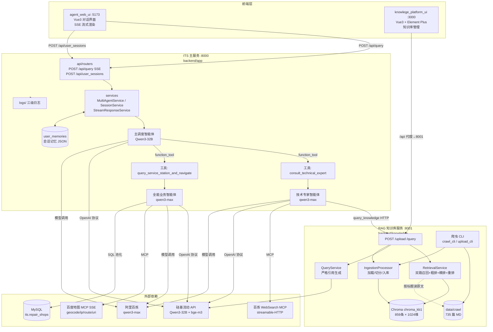
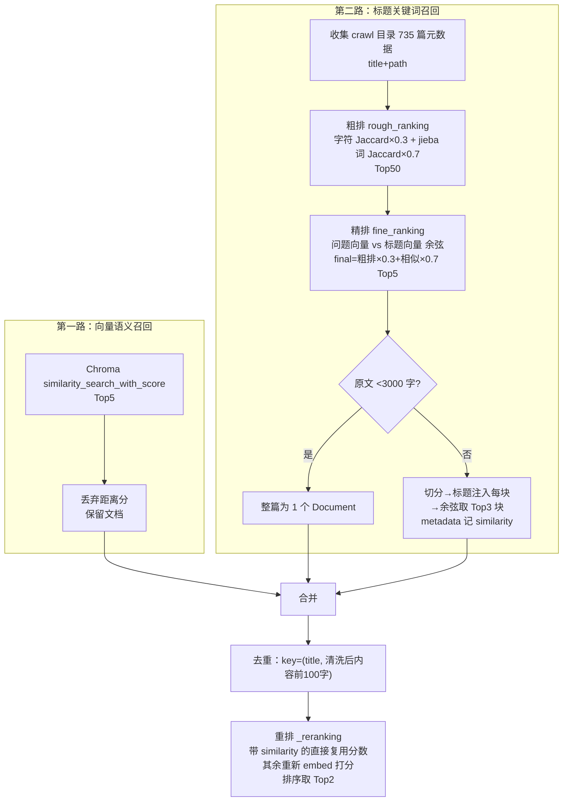
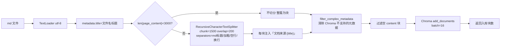
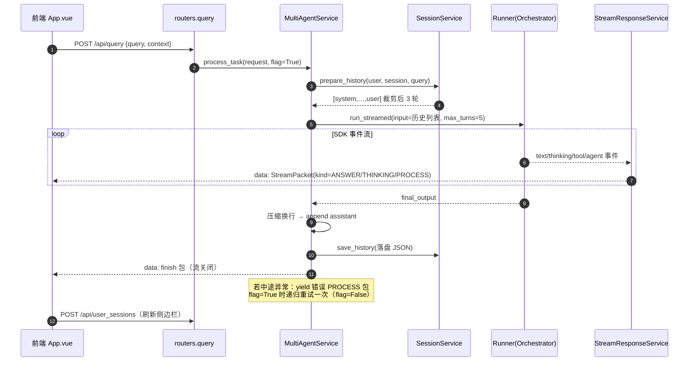
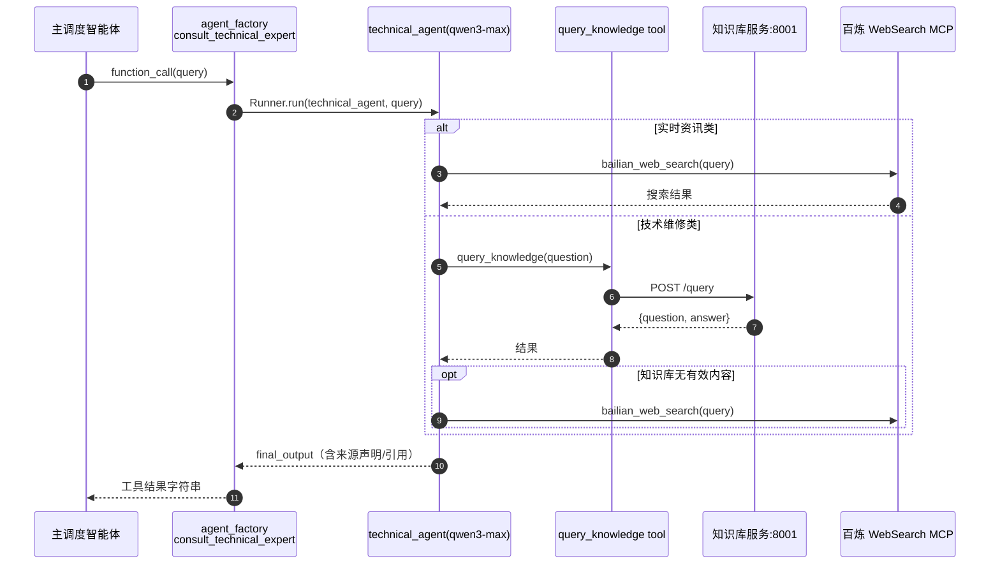
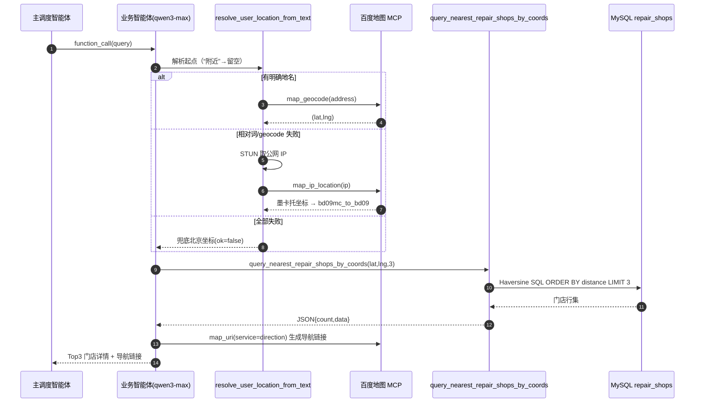

# 2_开发文档（ITS 多智能体系统）

> 编写视角：AI 开发工程师
> 更新时间：2026-11-04
> 读者对象：后端/前端/AI 应用开发者
> 统计口径：代码行数为**非空行**（PowerShell `Measure-Object -Line`），已排除 `node_modules`、`__pycache__`、`chroma_kb1`、`data/crawl`、`user_memories`、`.idea`、`package-lock.json` 等非源码内容；前端"函数数"为正则近似值（`function` / `const fn = (...)` / `=>`）。

---

## 目录

1. [技术架构](#1-技术架构)
2. [代码规模统计](#2-代码规模统计文件数行数函数数)
3. [目录结构详解](#3-目录结构详解)
4. [核心模块设计](#4-核心模块设计)
5. [关键流程时序图](#5-关键流程时序图)
6. [接口文档（API）](#6-接口文档api)
7. [SSE 流式协议规范](#7-sse-流式协议规范)
8. [数据模型](#8-数据模型)
9. [配置说明](#9-配置说明)
10. [扩展开发指南](#10-扩展开发指南)

---

## 1. 技术架构

### 1.1 技术选型总览

| 层 | 技术 | 版本/型号 | 用途 |
|---|---|---|---|
| LLM 编排 | OpenAI Agents SDK | `openai-agents 0.20.0` | 多智能体、`@function_tool`、MCP、流式事件（`Runner.run_streamed`） |
| 生成模型（主） | Qwen/Qwen3-32B | 硅基流动 SiliconFlow | 主调度智能体（temperature=0） |
| 生成模型（子） | qwen3-max | 阿里百炼 | 技术/业务子智能体 |
| Embedding | BAAI/bge-m3 | 1024 维 | 知识向量化（更换后必须重建向量库） |
| RAG | LangChain + Chroma | langchain-core/community/openai/chroma | 文档加载、切分、向量库、相似检索 |
| 中文分词 | jieba | — | 标题粗排关键词召回 |
| 相似度计算 | scikit-learn | cosine_similarity | 精排/重排打分 |
| 后端框架 | FastAPI + uvicorn | — | REST + SSE（`StreamingResponse`） |
| 数据库 | MySQL + pymysql + DBUtils(PooledDB) | 连接池 max=5 | 维修门店数据 |
| 配置管理 | pydantic-settings | — | `.env` 加载、校验 |
| 爬虫 | requests + BeautifulSoup(markdownify) + tqdm | — | 联想知识库批量采集 |
| 前端 | Vue 3 + Vite 5 | element-plus、marked、axios、vue-router | 两个独立 SPA |
| MCP | MCPServerStreamableHttp / MCPServerSse | — | 百炼 WebSearch（streamable-HTTP `/mcp`）、百度地图（SSE） |

### 1.2 系统架构图



### 1.3 分层设计（后端约定）

两个后端服务遵循同一套分层约定（虽为课程项目，结构清晰）：

```
api/            接口层：FastAPI 路由，参数校验（Pydantic），不做业务
services/       服务层：业务编排（Agent 运行、会话、流处理）
repositories/   仓储层：外部存储读写（JSON 文件 / Chroma / 文件系统）
infrastructure/ 基础设施：AI 客户端、MCP、数据库池、日志、工具实现
schemas/        数据契约：请求/响应模型
config/         配置：pydantic-settings 读 .env
utils/          纯函数工具
prompts/        提示词（markdown，与代码解耦）
```

---

## 2. 代码规模统计（文件数/行数/函数数）

### 2.1 模块级汇总

| 模块 | 路径 | 代码文件数 | 代码行数（非空） | 函数数 | 类数 | 说明 |
|---|---|---:|---:|---:|---:|---|
| ITS 主服务 | `backend/app` | 47 (.py) | 1,990 | 66 | 18 | 含测试脚本 tests/ |
| 知识库服务 | `backend/knowledge` | 34 (.py) | 1,263 | 40 | 13 | 含课程实验 test/ |
| 对话前端 | `front/agent_web_ui` | 6 (.vue/.js/.html/.css) | 3,337 | ≈60 | — | 核心 App.vue 单文件组件（总 1,832 行） |
| 知识库前端 | `front/knowlege_platform_ui` | 12 (.vue/.js/.html/.css/.scss) | 708 | ≈13 | — | 路由/布局/两页面/API 封装 |
| **主项目合计** | — | **99** | **7,298** | **≈179** | **31** | — |
| Agents SDK 练习 | `backend/openai-agents-tutorial` | 60 | 2,318 | ≈75 | 5 | 课程练习，与主项目无依赖 |
| **总计** | — | **159** | **9,616** | **≈254** | **36** | — |

### 2.2 ITS 主服务（backend/app）逐文件明细

| 文件 | 行数 | 函数 | 类 | 职责 |
|---|---:|---:|---:|---|
| `api/main.py` | 52 | 2 | 0 | FastAPI 实例、CORS、lifespan 管理 MCP 连接 |
| `api/routers.py` | 65 | 2 | 0 | `/api/query`(SSE)、`/api/user_sessions` |
| `config/settings.py` | 93 | 1 | 1 | pydantic-settings 配置 + AI 服务校验器 |
| `config/test_settings.py` | 68 | 3 | 0 | 配置自测脚本 |
| `infrastructure/ai/openai_client.py` | 27 | 0 | 0 | 主/子模型 `OpenAIChatCompletionsModel` 客户端 |
| `infrastructure/ai/prompt_loader.py` | 32 | 1 | 0 | 从 prompts/ 加载 markdown 提示词 |
| `infrastructure/database/database_pool.py` | 58 | 2 | 1 | DBUtils PooledDB 连接池（单例） |
| `infrastructure/logging/logger.py` | 85 | 2 | 1 | 彩色控制台 + 3 个按天轮转文件 Handler |
| `infrastructure/tools/local/knowledge_base.py` | 38 | 2 | 0 | `@function_tool query_knowledge`：HTTP 调 8001 |
| `infrastructure/tools/local/service_station.py` | 213 | 4 | 0 | 位置解析（geocode→IP→兜底）、坐标转换、Haversine 门店 SQL |
| `infrastructure/tools/mcp/mcp_servers.py` | 146 | 4 | 0 | 两个 MCP 客户端定义 + 连通性测试执行器 |
| `infrastructure/tools/mcp/mcp_manager.py` | 25 | 2 | 0 | 应用级 MCP connect/cleanup |
| `multi_agent/agent_factory.py` | 110 | 7 | 0 | 子智能体包装为 `@function_tool`（Agent-as-Tool） |
| `multi_agent/orchestrator_agent.py` | 94 | 2 | 0 | 主调度智能体定义 + 独立测试入口 |
| `multi_agent/service_agent.py` | 88 | 2 | 0 | 全能业务智能体定义 + 测试入口 |
| `multi_agent/technical_agent.py` | 43 | 2 | 0 | 技术专家智能体定义 + 测试入口 |
| `repositories/session_repository.py` | 98 | 6 | 1 | 会话 JSON 文件 CRUD（user_memories/） |
| `schemas/request.py` | 21 | 0 | 3 | ChatMessageRequest / UserContext / UserSessionsRequest |
| `schemas/response.py` | 54 | 0 | 8 | SSE StreamPacket 协议模型（kind/status/finish） |
| `services/agent_service.py` | 67 | 1 | 1 | `MultiAgentService.process_task`：入口编排+失败自动重试一次 |
| `services/session_service.py` | 172 | 7 | 1 | 历史加载/裁剪(3 轮)/保存/会话列表格式化 |
| `services/stream_response_service.py` | 66 | 1 | 0 | Agents SDK 事件流 → SSE StreamPacket 转换 |
| `utils/response_util.py` | 44 | 2 | 1 | StreamPacket 构造工厂 |
| `utils/text_util.py` | 59 | 2 | 0 | 工具名→业务名映射、过程卡片 HTML |
| `mcp_check.py` | 84 | 4 | 0 | MCP 连通性体检脚本 |
| `tests/*`（4 个） | 57 | 5 | 0 | 坐标转换/异步/IP/json 零散验证 |
| 其余 `__init__.py` × 13 | 0 | — | — | 包标记 |

### 2.3 知识库服务（backend/knowledge）逐文件明细

| 文件 | 行数 | 函数 | 类 | 职责 |
|---|---:|---:|---:|---|
| `api/main.py` | 23 | 1 | 0 | FastAPI 实例（8001） |
| `api/routers.py` | 84 | 2 | 0 | `/upload`（aiofiles 分块写盘+线程池入库）、`/query` |
| `config/settings.py` | 34 | 0 | 1 | 路径/切分/检索参数配置 |
| `cli/crawl_cli.py` | 45 | 1 | 0 | 爬取 1..1000 号知识 → `{0001}-{标题}.md` |
| `cli/upload_cli.py` | 35 | 1 | 0 | 扫描 crawl 目录去重后全量入库（tqdm 进度） |
| `repositories/vector_store_repository.py` | 83 | 5 | 1 | Chroma 封装：批量 add(16/批)、embed、带分检索 |
| `repositories/file_repository.py` | 112 | 5 | 1 | 文件保存/列举/去重 |
| `schemas/schema.py` | 20 | 0 | 3 | UploadResponse / QueryRequest / QueryResponse |
| `services/retrieval_service.py` | 309 | 9 | 1 | **检索核心**：粗排/精排/双路召回/去重/重排/长文切块 |
| `services/query_service.py` | 51 | 2 | 1 | ChatOpenAI 生成 + 严格提示词（防幻觉/去品牌化/引用） |
| `services/crawler/client.py` | 38 | 1 | 1 | 联想知识 API HTTP 客户端 |
| `services/crawler/parser.py` | 68 | 1 | 1 | HTML→结构化 Markdown（标题/摘要/分类/关键词/元信息/方案） |
| `services/ingestion/ingestion_processor.py` | 102 | 2 | 1 | 切分（1500/200，短文不切）、标题注入、元数据过滤、入库 |
| `utils/markdown_utils.py` | 60 | 4 | 1 | 标题提取、md 元数据收集 |
| `utils/text_utils.py` | 52 | 2 | 1 | HTML→MD（markdownify）、文件名清洗 |
| `test/*`（9 个） | 152 | 8 | 0 | jieba/bs4/enumerate 等课程实验脚本 |

---

## 3. 目录结构详解

```
its_multi_agent/
├── backend/
│   ├── app/                          # ★ ITS 主服务（8000）
│   │   ├── api/                      #   main.py(实例+lifespan) / routers.py(路由)
│   │   ├── config/                   #   settings.py(.env) / test_settings.py
│   │   ├── infrastructure/
│   │   │   ├── ai/                   #   openai_client.py(模型客户端) prompt_loader.py
│   │   │   ├── database/             #   database_pool.py(DBUtils 池)
│   │   │   ├── logging/              #   logger.py(3 级轮转日志)
│   │   │   └── tools/
│   │   │       ├── local/            #   knowledge_base.py service_station.py（本地 function_tool）
│   │   │       └── mcp/              #   mcp_servers.py mcp_manager.py
│   │   ├── multi_agent/              #   orchestrator/technical/service + agent_factory
│   │   ├── prompts/                  #   orchestrator_v1.md technical_agent.md comprehensive_service_agent.md
│   │   ├── repositories/             #   session_repository.py（JSON 会话）
│   │   ├── schemas/                  #   request.py response.py（SSE 协议）
│   │   ├── services/                 #   agent_service.py session_service.py stream_response_service.py
│   │   ├── utils/                    #   response_util.py text_util.py
│   │   ├── tests/                    #   4 个零散验证脚本
│   │   ├── user_memories/            #   会话记忆存储（gitignore）
│   │   ├── logs/                     #   运行日志（gitignore）
│   │   ├── mcp_check.py              #   MCP 连通性体检
│   │   ├── setup.py / .env(.example)
│   ├── knowledge/                    # ★ 知识库服务（8001）
│   │   ├── api/                      #   main.py / routers.py(upload,query)
│   │   ├── cli/                      #   crawl_cli.py upload_cli.py
│   │   ├── config/settings.py
│   │   ├── repositories/             #   vector_store_repository.py file_repository.py
│   │   ├── schemas/schema.py
│   │   ├── services/
│   │   │   ├── crawler/              #   client.py parser.py
│   │   │   ├── ingestion/            #   ingestion_processor.py
│   │   │   ├── retrieval_service.py  #   ★ 检索管线
│   │   │   └── query_service.py      #   生成
│   │   ├── utils/                    #   markdown_utils.py text_utils.py
│   │   ├── chroma_kb1/               #   Chroma 持久化（gitignore，859 条）
│   │   ├── data/crawl/               #   735 篇知识 MD（gitignore）
│   │   ├── test/                     #   课程实验脚本
│   │   └── setup.py / .env(.example)
│   └── openai-agents-tutorial/       # Agents SDK 分层练习（00~07 主题）
└── front/
    ├── agent_web_ui/                 # ★ 对话前端（5173，直连 8000）
    │   └── src/App.vue               #   单文件组件 1832 行（登录/侧边栏/SSE/渲染）
    └── knowlege_platform_ui/         # ★ 知识库前端（3000，/api 代理→8001）
        └── src/{api,router,layout,views}
```

---

## 4. 核心模块设计

### 4.1 多智能体编排（backend/app/multi_agent）

**三个 Agent 的定义要点**（均 `temperature=0`，`RunConfig(tracing_disabled=True)`）：

| Agent | 模型 | 工具（tools） | MCP | 提示词 |
|---|---|---|---|---|
| `orchestrator_agent` 主调度 | Qwen3-32B（硅基流动） | `AGENT_TOOLS`（下面两个子智能体的包装） | 无 | `prompts/orchestrator_v1.md`：只识别当前消息任务、按序调用、结果按序拼接、原样输出、禁止画蛇添足 |
| `technical_agent` 技术专家 | qwen3-max（百炼） | `query_knowledge` | `search_mcp_client`（WebSearch） | `prompts/technical_agent.md`：实时资讯直接联网；技术问题先知识库、无果再联网并声明来源；越界拒绝 |
| `comprehensive_service_agent` 业务专家 | qwen3-max（百炼，max_tokens=2048） | `resolve_user_location_from_text`、`query_nearest_repair_shops_by_coords` | `baidu_mcp_client`（百度地图） | `prompts/comprehensive_service_agent.md`：服务站流程与普通 POI 流程严格隔离；强制输出 Top3 门店+导航链接 |

**Agent-as-Tool 模式**（`agent_factory.py`）：子智能体不是通过 handoff 交接，而是包装成 `@function_tool` 供主调度调用——

```python
async def consult_technical_expert_impl(query: str) -> str:
    result = await Runner.run(technical_agent, input=query,
                              run_config=RunConfig(tracing_disabled=True))
    return result.final_output

@function_tool
async def consult_technical_expert(query: str) -> str:
    """【咨询与技术专家】处理技术咨询、设备故障、维修建议以及实时资讯……"""
    return await consult_technical_expert_impl(query)
```

设计细节：
- 业务逻辑放在 `*_impl` 普通函数中，`@function_tool` 包装器与测试代码共用，避免"工具对象不能直接调用"的坑；
- 子智能体运行失败时返回中文错误文案（不抛异常），保证主调度能继续聚合；
- 主调度 `max_turns=5`（COT 迭代上限），由 `agent_service.py` 传入。

### 4.2 服务编排与会话（backend/app/services）

`MultiAgentService.process_task(request, flag)` 是**整条链路的入口**（async 生成器）：

1. `session_service.prepare_history()`：加载历史 → 追加本轮 user 消息 → 裁剪保留最近 3 轮（system 消息必留）；
2. `Runner.run_streamed(orchestrator_agent, input=chat_history, context=user_query, max_turns=5)`：注意 input 是**消息列表**（带历史）；
3. `process_stream_response()`：把 SDK 事件翻译成 SSE 包逐个 `yield`；
4. 流结束后取 `final_output`，正则压缩多余换行，`chat_history.append(assistant 消息)` 并落盘；
5. **异常处理**：失败时 yield 一条 `❌ 系统错误` 的 PROCESS 包；若 `flag=True` 则提示"正在尝试自动重试"并**递归调用自身一次**（`flag=False` 防止无限重试）。

会话存储结构（`user_memories/{user_id}/{session_id}.json`）：

```json
[
  {"role": "system",    "content": "你是一个有记忆的智能体助手……"},
  {"role": "user",      "content": "……"},
  {"role": "assistant", "content": "……"}
]
```

- `session_id` 缺省为 `default_session`；新会话由**前端生成**（`session_{时间戳}_{随机串}`）；
- 读取失败（JSON 损坏）返回兜底 system 消息，隔离单文件损坏；
- 会话列表接口按文件创建时间倒序，过滤 system 消息后返回。

### 4.3 SSE 流式协议（schemas/response.py + stream_response_service.py）

SDK 事件 → SSE 数据包的映射规则：

| SDK 事件 | 识别条件 | 生成包 kind | 前端渲染 |
|---|---|---|---|
| `raw_response_event` + `ResponseTextDeltaEvent` | 文本增量 | `ANSWER` | 主气泡打字机 |
| `raw_response_event` + `ResponseReasoningTextDeltaEvent` | 推理模型思考增量 | `THINKING` | 可折叠"思考过程" |
| `raw_response_event` + `ResponseReasoningSummaryTextDeltaEvent` | 非 OpenAI 推理摘要 | `THINKING` | 同上 |
| `run_item_stream_event(name=tool_called)` | `ToolCallItem` | `PROCESS` | "正在调用工具"卡片（工具名映射为业务名） |
| `agent_updated_stream_event` | Agent 切换 | `PROCESS` | "智能体切换"卡片 |
| 流结束 | — | `sagegpt/finish` 结束包 | 结束本次流 |

### 4.4 RAG 检索管线（backend/knowledge/services/retrieval_service.py）

**两路召回 + 三段排序**，最终返回 Top2 文档给生成：



要点：
- 去重 key 会先剔除 page_content 前缀 `文档来源:…`，避免同文多块重复入选；
- 长文切块（`_deal_long_title_content`）的 metadata 带 `similarity`，重排时直接复用，**不重复嵌入**；
- 生成提示词（`query_service.py`）要求：严格基于资料、资料不足直说"当前的知识库中暂时没有找到该问题的解决方案"、去品牌化（"联想 K900"→"手机"）、结构化有序列表、结尾列出引用 `【资料x】` 编号。

### 4.5 文档摄入管线（ingestion_processor.py）



注意：`config/settings.py` 里的 `CHUNK_SIZE=3000` 是**遗留配置**，实际切分参数以 `IngestionProcessor` 构造函数里的 `1500/200` 为准；`<3000 字不切分`的阈值也是硬编码在该类中。

### 4.6 门店查询与定位（infrastructure/tools/local/service_station.py）

- **`resolve_user_location_from_text(user_input)`**（异步 function_tool）：
  1. 相对词黑名单（"附近/这里/我的位置…"）命中 → 强制走 IP；
  2. 非空地名 → MCP `map_geocode`，成功返回 `(lat,lng,source=geocode)`；失败吞异常继续；
  3. STUN 取公网 IP（`stun.get_ip_info()`）→ MCP `map_ip_location` → 返回**墨卡托坐标** → `bd09mc_to_bd09()` 转经纬度；
  4. 兜底：北京天安门 `(39.9042, 116.4074)`，`ok=false`。
- **`query_nearest_repair_shops_by_coords(lat, lng, limit=3)`**（同步 function_tool）：DBUtils 池化连接 + Haversine SQL：

```sql
6371 * acos( cos(radians(%s)) * cos(radians(latitude)) *
             cos(radians(longitude) - radians(%s)) +
             sin(radians(%s)) * sin(radians(latitude)) ) AS distance_km
```
  过滤非法坐标（`|lat|<=90, |lng|<=180`），按距离升序 `LIMIT %s`，`finally` 中确保 cursor/connection 归还池。

### 4.7 MCP 集成（infrastructure/tools/mcp/）

| 客户端 | 类 | 传输 | 地址 | 关键参数 |
|---|---|---|---|---|
| `search_mcp_client` 百炼 WebSearch | `MCPServerStreamableHttp` | streamable-HTTP（`/mcp`） | `settings.DASHSCOPE_BASE_URL` | Authorization: Bearer DASHSCOPE_API_KEY；timeout=60；sse_read_timeout=1800；session=600；cache_tools_list=True |
| `baidu_mcp_client` 百度地图 | `MCPServerSse` | SSE（`/sse?ak=…`） | `https://mcp.map.baidu.com/sse` | timeout=60；sse_read_timeout=1800；session=600；cache_tools_list=True |

生命周期：`api/main.py` 的 `lifespan` 在启动时 `mcp_connect()`（百度优先，各自 try/except 记日志互不阻断），关闭时 `mcp_cleanup()`。
工具清单（经 MCP 暴露给智能体）：`bailian_web_search`；`map_geocode`、`map_ip_location`、`map_search_places`、`map_uri` 等。
体检：`python mcp_check.py [search|baidu|all]`。

### 4.8 前端要点

**agent_web_ui（App.vue，单文件 1832 行）**
- 状态：`isLoggedIn`（默认 true，配合 localStorage `currentUserId` 恢复）、`chatMessages[]`（统一消息流，type=user/assistant/THINKING/PROCESS）、`sessions[]`、`selectedSessionId`；
- 发送：`fetch('http://127.0.0.1:8000/api/query')` → `response.body.getReader()` 手工解析 SSE：按 `\n` 切行缓冲，`data:` 前缀剥除后 `JSON.parse`，按 `content.kind` 分发（兼容旧版 `type` 字段与降级结构）；
- 请求体：`{ query, context: { user_id, session_id }, flag 可省 }`；
- 新会话 ID 在前端生成；每轮结束后调 `/api/user_sessions` 刷新侧边栏；
- 取消：`reader.cancel()`；Markdown 用 marked（GFM）渲染。

**knowlege_platform_ui**
- Vite `server.proxy`：`/api → http://127.0.0.1:8001`（去掉 `/api` 前缀），前端 axios 只写相对路径；
- `views/Knowledge.vue`：el-upload 拖拽上传（`http-request` 自定义，FormData → `/api/upload`），上传历史表格；
- `views/Chat.vue`：对知识库直问验证效果。

---

## 5. 关键流程时序图

### 5.1 一次完整 SSE 对话（含重试分支）



### 5.2 技术专家内部调用链



### 5.3 业务专家门店查询链



---

## 6. 接口文档（API）

### 6.1 ITS 主服务（http://127.0.0.1:8000，docs: `/docs`）

**POST /api/query** —— 智能体对话（SSE 流式）

请求体：
```json
{
  "query": "电脑开机之后无任何反应怎么办",
  "context": { "user_id": "root1", "session_id": "session_1730000000_abc" },
  "flag": true
}
```
| 字段 | 类型 | 必填 | 说明 |
|---|---|---|---|
| query | string | 是 | 用户问题 |
| context.user_id | string | 是 | 用户标识（会话文件目录名） |
| context.session_id | string | 否 | 为空则落 `default_session` |
| flag | bool | 否 | 默认 true；失败时允许自动重试一次 |

响应：`text/event-stream`，每行 `data: {StreamPacket JSON}\n\n`，协议见第 7 节。

**POST /api/user_sessions** —— 获取用户全部会话

请求：`{"user_id": "root1"}`
响应：
```json
{
  "success": true,
  "user_id": "root1",
  "total_sessions": 3,
  "sessions": [
    { "session_id": "session_…", "create_time": "2026-11-04 21:00:00",
      "memory": [{"role":"user","content":"…"}, {"role":"assistant","content":"…"}],
      "total_messages": 4 }
  ]
}
```
（按创建时间倒序；system 消息已过滤；损坏文件返回 `error: "无法读取会话数据"` 且不拖垮整个列表。）

### 6.2 知识库服务（http://127.0.0.1:8001，docs: `/docs`）

**POST /upload**（multipart/form-data，字段 `file`）

响应：
```json
{ "status": "success", "message": "文档上传知识库成功",
  "file_name": "0430-联想手机K900常见问题汇总.md", "chunks_added": 12 }
```
实现要点：aiofiles 1MB 分块写临时文件 → move 到 `data/tmp` → `run_in_threadpool(ingest_file)`（阻塞的向量化入库不卡事件循环）→ finally 删除临时文件。注意当前**无去重**（代码 TODO），重复上传同一文件会重复入库。

**POST /query**
```json
请求: {"question": "手机、平板上的画面能无线传输到电视上播放吗"}
响应: {"question": "…", "answer": "…（末尾含引用【资料x】编号）"}
```
异常统一 500（`"服务内部出现异常"`），问题为空 500（`"查询问题不存在"`）。

---

## 7. SSE 流式协议规范

顶层包 `StreamPacket`：

```json
{
  "id": "uuid",
  "status": "IN_PROGRESS | FINISHED",
  "metadata": { "createTime": "2026-11-04 21:00:00", "finishReason": null, "errorMessage": null },
  "content": {
    "contentType": "sagegpt/text",
    "text": "片段文本",
    "kind": "ANSWER | THINKING | PROCESS"
  }
}
```
结束包 `content.contentType = "sagegpt/finish"`（无 text/kind），`status=FINISHED`。

前端解析契约（App.vue `processSSEData`）：
1. 仅处理 `data:` 开头行；
2. `content.kind` 优先，兼容旧字段 `content.type`；
3. `status==='FINISHED'` 或 `contentType==='sagegpt/finish'` 时结束；
4. 降级兼容 `{type, content}` 旧结构；
5. `ANSWER`→答案气泡追加；`THINKING`/`PROCESS`→思考折叠区追加（连续片段自动合并同一条消息）。

---

## 8. 数据模型

### 8.1 MySQL `repair_shops`（门店表，SQL 查询字段全集）

| 字段 | 含义 |
|---|---|
| id | 主键 |
| service_station_name | 服务站名称（含品牌） |
| province / city / district / address | 行政区划与详细地址 |
| phone | 联系电话 |
| manager / manager_phone | 负责人及电话 |
| opening_hours | 营业时间 |
| repair_types / repair_specialties / repair_services | 维修类型/专长/服务 |
| supported_brands | 支持品牌 |
| rating | 评分 |
| established_year / employee_count | 成立年份 / 员工数 |
| service_station_description | 描述 |
| latitude / longitude | 纬度/经度（BD09LL，查询条件 `IS NOT NULL` 且 `|lat|≤90, |lng|≤180`） |

> 当前 `its` 库与 `repair_shops` 表已建立并可正常访问；字段清单自 `service_station.py` 的 SELECT 反推（仓库不含建表 SQL，全新环境部署时需据此自行建表）。

### 8.2 Chroma 向量库

- 路径 `backend/knowledge/chroma_kb1/`，collection：`its-knowledge`；
- 向量：bge-m3，1024 维，当前 859 条；
- 入库 metadata 经 `filter_complex_metadata` 清洗（保留 source 等），检索侧自建 metadata：`path/title/chunk_index/similarity`。

### 8.3 会话记忆 JSON

见 4.2 节；目录结构 `user_memories/{user_id}/{session_id}.json`，`get_all_sessions_metadata` 以文件 `st_ctime` 作为创建时间。

---

## 9. 配置说明

### 9.1 backend/app/.env（模板 `.env.example`）

| 变量 | 说明 | 示例 |
|---|---|---|
| SF_API_KEY / SF_BASE_URL | 硅基流动（主模型客户端） | `https://api.siliconflow.cn/v1` |
| MAIN_MODEL_NAME | 主调度模型 | `Qwen/Qwen3-32B` |
| AL_BAILIAN_API_KEY / AL_BAILIAN_BASE_URL | 百炼（子模型客户端） | `…/compatible-mode/v1` |
| SUB_MODEL_NAME | 子智能体模型 | `qwen3-max` |
| MYSQL_HOST/PORT/USER/PASSWORD/DATABASE/CHARSET/CONNECT_TIMEOUT/MAX_CONNECTIONS | 门店库连接 | 库名 `its` |
| DASHSCOPE_BASE_URL | **必须是 `/mcp` 端点**（阿里已下线 `/sse`） | `https://dashscope.aliyuncs.com/api/v1/mcps/WebSearch/mcp` |
| DASHSCOPE_API_KEY | 搜索 MCP 专用 key（与子模型 key 解耦） | — |
| BAIDUMAP_AK | 百度地图开放平台 AK | — |
| KNOWLEDGE_BASE_URL | 知识库服务地址 | `http://127.0.0.1:8001` |

校验：`Settings` 的 `model_validator` 要求「硅基流动 或 百炼」至少配置一组，否则启动即抛错。

### 9.2 backend/knowledge/.env

| 变量 | 说明 |
|---|---|
| API_KEY / BASE_URL | 硅基流动（LLM 与 Embedding 共用） |
| MODEL | 生成模型 `Qwen/Qwen3-32B` |
| EMBEDDING_MODEL | `BAAI/bge-m3`（**更换后必须 `python -m cli.upload_cli` 重建向量库**） |
| KNOWLEDGE_BASE_URL | 爬虫目标站 `https://iknow.lenovo.com.cn` |

代码内固定参数：向量库 `chroma_kb1`、crawl 目录 `data/crawl`、临时目录 `data/tmp`、粗排 Top50 / 精排 Top5 / 最终 Top2、长文阈值 3000 字。

---

## 10. 扩展开发指南

### 10.1 新增一个本地 function_tool

1. 在 `infrastructure/tools/local/` 下实现 async 函数，打上 `@function_tool`；docstring **就是给 LLM 看的工具说明书**（写清适用场景与参数含义，直接影响调度准确率）；
2. 复杂逻辑放 `*_impl` 普通函数供测试；
3. 把工具加入对应 Agent 的 `tools=[...]`（`multi_agent/*_agent.py`）；
4. 在 `utils/text_util.py` 的 `TOOL_NAME_MAPPING` 加映射，让前端过程卡片显示业务名；
5. 若产生新的 SSE 事件形态，扩展 `stream_response_service.py`。

### 10.2 新增一个专家智能体（新业务域）

1. 写提示词 `prompts/{new_agent}.md`（角色定位/流程/约束/输出格式/拒绝话术）；
2. `multi_agent/new_agent.py`：`Agent(name=…, instructions=load_prompt("new_agent"), model=sub_model, tools=…, mcp_servers=…)`；
3. `agent_factory.py`：新增 `xxx_impl` + `@function_tool` 包装，加入 `AGENT_TOOLS`；
4. 更新 `orchestrator_v1.md` 的"可用工具"清单与任务分流示例（这一步决定调度台会不会用新工具）；
5. 冒烟：直接运行 `python -m multi_agent.new_agent`（各文件都内置了 `__main__` 测试台）。

### 10.3 更换模型 / Embedding

- 换生成模型：改 `.env` 的 `MAIN_MODEL_NAME` / `SUB_MODEL_NAME`，重启即可；
- 换 Embedding：改 knowledge `.env` 的 `EMBEDDING_MODEL` 后**必须**删除 `chroma_kb1/` 并执行 `python -m cli.upload_cli` 全量重建（维度不同旧库不可用）。

### 10.4 已知技术债（开发时注意）

| 位置 | 问题 | 建议 |
|---|---|---|
| `agent_service.py` | 异常重试为递归调用自身，`max_turns` 注释与语义需甄别 | 改为显式循环 |
| `routers.py` | `print(request_context.flag)` 遗留调试输出 | 移除 |
| `service_agent.py` | `set_tracing_disabled(True)` 全局副作用 | 收敛到 RunConfig |
| `knowledge/routers.py upload` | 无文件去重/无大小限制/非 md 未拦截 | 加白名单与去重键 |
| `retrieval_service._search_based_title` | 打开单文件失败会 `return []` 丢失整路结果 | 改 continue |
| `settings.py(knowledge)` | 类属性混用 `os.environ.get` 与 pydantic 字段，风格不统一 | 统一 Field |
| 前端 App.vue | 1832 行单文件、后端地址硬编码 `127.0.0.1:8000` | 拆组件 + 环境变量化 API 地址 |
| 登录 | 3 个演示账号硬编码在前端 | 接后端鉴权 |

---

## 附录：关联文档

- [1_产品文档](1_产品文档.md) ｜ [3_测试文档](3_测试文档.md) ｜ [4_运维文档](4_运维文档.md) ｜ [5_学习文档](5_学习文档.md)
