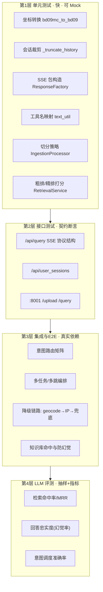

# 3_测试文档（ITS 多智能体系统）

> 编写视角：资深测试工程师
> 更新时间：2026-11-04
> 读者对象：测试工程师、开发自测、质量负责人
> 被测版本：仓库 `its_multi_agent` 主干（cf0bcb1）

---

## 目录

1. [测试对象与范围](#1-测试对象与范围)
2. [测试策略总体设计](#2-测试策略总体设计)
3. [测试环境与前置条件](#3-测试环境与前置条件)
4. [现有测试资产盘点与缺口分析](#4-现有测试资产盘点与缺口分析)
5. [单元测试方案](#5-单元测试方案)
6. [接口测试方案](#6-接口测试方案)
7. [端到端场景测试（含 LLM 专项）](#7-端到端场景测试含-llm-专项)
8. [性能与专项测试](#8-性能与专项测试)
9. [缺陷管理与准入准出](#9-缺陷管理与准入准出)
10. [附录：用例跟踪清单](#10-附录用例跟踪清单)

---

## 1. 测试对象与范围

| 子系统 | 测试重点 | 难点 |
|---|---|---|
| ITS 主服务（8000） | SSE 流式接口、多智能体调度、会话记忆、工具调用 | LLM 输出不确定，需要"契约断言 + 语义评测"结合 |
| RAG 知识库服务（8001） | 检索质量（召回/排序）、上传入库、生成防幻觉 | 检索质量指标（命中率/MRR）需建评测集 |
| 对话前端（5173） | SSE 解析、会话管理、渲染、取消 | 流式 UI 状态机 |
| 知识库前端（3000） | 上传链路、代理转发 | 与 8001 联动 |
| 外部依赖 | 百炼 WebSearch MCP、百度地图 MCP、硅基流动/百炼模型、MySQL | 不可控第三方，需分层隔离（Mock/真实） |

**范围内**：以上五个模块的功能、接口、集成、E2E、专项（检索质量/流式性能/MCP 连通性）。
**范围外**：`backend/openai-agents-tutorial/`（课程练习）、爬虫对目标站的合规性（仅验证脚本可用性）。

---

## 2. 测试策略总体设计

采用分层测试金字塔，并为 LLM 环节增加"评测层"：



**确定性原则**：LLM 相关断言只做"结构/路由/来源声明"等确定性契约；内容质量交给评测层抽样。
**依赖隔离原则**：单测不连网、不连库；接口测试可连本机 Chroma/JSON；E2E 才允许真实调用第三方（标注消耗额度）。

---

## 3. 测试环境与前置条件

| 项 | 要求 |
|---|---|
| OS / Python | Windows（当前开发环境）；Python ≥3.10，安装 `backend/app/setup.py` 与 `backend/knowledge/setup.py` 依赖（pytest 需另行安装） |
| 服务启动顺序 | 8001 知识库 → 8000 主服务 →（E2E 才需要）前端 5173/3000 |
| 配置 | 两个 `.env` 按 `.env.example` 配齐（SF/Bailian/DashScope/百度 AK/MySQL） |
| 数据 | `chroma_kb1`（859 条）与 `data/crawl`（735 篇）就位；MySQL `its.repair_shops` 已建库可正常访问（门店类用例可直接执行） |
| 账号 | 前端演示账号 root1/root2/root3（123456） |
| 已知限制 | 无 CI、无 pytest 配置；`backend/knowledge/test/` 为课程实验脚本，不作为回归集 |

---

## 4. 现有测试资产盘点与缺口分析

### 4.1 已有资产

| 资产 | 位置 | 性质 | 可复用度 |
|---|---|---|---|
| `mcp_check.py` | backend/app | MCP 连通性体检（search/baidu/all） | ★★★ 冒烟必备 |
| `mcp_servers.py` 内 `run_mcp_call`/`debug_*` | backend/app | 工具列表+调用+打印的调试执行器 | ★★★ 可改编为集成用例 |
| 各 Agent 文件 `__main__` 测试台 | multi_agent/*.py | 内置中文用例集（组合任务/多跳/拒绝用例注释保留很全） | ★★★ E2E 场景库 |
| `config/test_settings.py` | backend/app | 配置加载自检 | ★★ |
| `tests/test_bd09mc_to_bd09.py` 等 4 个 | backend/app/tests | 零散验证（无断言框架） | ★ 改造为 pytest |
| `knowledge/test/*` 9 个 | backend/knowledge | bs4/jieba 等课程实验 | ☆ 不纳入回归 |

### 4.2 缺口分析（测试 Left Shift 建议）

| 缺口 | 风险 | 建议 |
|---|---|---|
| 无任何框架化单测（无 pytest/unittest 断言） | 回归靠手工 | 按第 5 节补齐 P0 单测（约 1 天工作量） |
| SSE 协议无契约测试 | 后端字段变更前端解析断裂（代码里已有兼容补丁痕迹） | 增加 SSE 结构断言用例 |
| 检索质量无评测集 | 调参（权重/TopN/切分）无回归基线 | 从 crawl 目录抽取 50–100 条"问题→应命中文档"建 JSONL 评测集 |
| 上传无去重 | 重复上传导致向量库膨胀、检索重复 | 上传接口增加用例暴露该缺陷（已知问题） |
| 无性能基线 | 首字延迟/并发能力未知 | 第 8 节方案 |

---

## 5. 单元测试方案

框架建议：`pytest` + `pytest-asyncio`；外部 HTTP/MCP/DB 一律 Mock。

### 5.1 P0 用例表

| ID | 被测单元 | 用例 | 断言要点 |
|---|---|---|---|
| UT-01 | `service_station.bd09mc_to_bd09` | 天安门墨卡托坐标 (12958117.36, 4825913.85) | 输出≈(116.404, 39.915)，误差 <0.01 |
| UT-02 | 同上 | x/y 过小（<1e-6） | 返回 (0.0, 0.0) |
| UT-03 | `SessionService._truncate_history` | 10 轮对话 + 1 条 system，max_turn=3 | 保留 system + 最近 3 轮（6 条），顺序不变 |
| UT-04 | 同上 | 仅 system | 原样保留 |
| UT-05 | `SessionService.prepare_history` | 空历史目录 | 返回带默认 system 的单条列表，且 user 消息在末尾 |
| UT-06 | `ResponseFactory.build_text/build_finish` | 构造三种 kind 与 finish 包 | contentType/kind/status/metadata 字段齐全、uuid 唯一 |
| UT-07 | `text_util.format_tool_call_html` | 传入 `bailian_web_search` | 输出含"联网搜索"；未知名原样透传 |
| UT-08 | `RetrievalService.rough_ranking` | 构造 3 个标题（含完全匹配/部分匹配/无关） | 完全匹配第一；返回 ≤50 条；含 roughing_score 字段 |
| UT-09 | `RetrievalService.fine_ranking` | Mock embed 返回可控向量 | final = 0.3*rough + 0.7*cos；按 final 降序 |
| UT-10 | `RetrievalService._deduplicate` | 两路含同标题同前缀文档 | 去重后保留 1 条（先剔除"文档来源:"前缀再比较） |
| UT-11 | `IngestionProcessor` 切分分支 | <3000 字文档 / >3000 字文档 | 短文 1 块；长文每块 page_content 带"文档来源:{title}"前缀 |
| UT-12 | `VectorStoreRepository.add_documents` | Mock Chroma，20 块 batch=16 | 调用 2 次，数量 16+4 计数正确 |
| UT-13 | `query_knowledge`（Mock httpx） | 200 / HTTPError / 超时 | 正常返回 JSON；异常返回 `{"status":"error",...}` 不抛出 |
| UT-14 | `stream_response_service` 事件映射 | 喂入 4 类 SDK 事件 Mock | 分别产出 ANSWER/THINKING/PROCESS/finish 包，行格式 `data: {json}\n\n` |

### 5.2 单测示例（可直接落地）

```python
# backend/app/tests/test_session_service.py
from services.session_service import SessionService

def test_truncate_keeps_system_and_three_turns():
    svc = SessionService()
    msgs = [{"role": "system", "content": "sys"}]
    for i in range(10):
        msgs.append({"role": "user", "content": f"u{i}"})
        msgs.append({"role": "assistant", "content": f"a{i}"})
    out = svc._truncate_history(msgs, max_turn=3)
    assert out[0]["role"] == "system"
    assert len(out) == 1 + 6            # system + 3 轮(user+assistant)
    assert out[-1]["content"] == "a9"   # 保留最近一轮
    assert "u3" not in [m["content"] for m in out]
```

```python
# backend/app/tests/test_bd09mc.py
from infrastructure.tools.local.service_station import bd09mc_to_bd09

def test_tiananmen_mercator():
    lng, lat = bd09mc_to_bd09(12958117.36, 4825913.85)
    assert abs(lng - 116.404) < 0.05
    assert abs(lat - 39.915) < 0.05

def test_invalid_coords():
    assert bd09mc_to_bd09(0.0, 0.0) == (0.0, 0.0)
```

```python
# backend/knowledge/test/test_dedup.py
from langchain_core.documents import Document
from services.retrieval_service import RetrievalService

def test_dedup_strips_source_prefix():
    svc = RetrievalService.__new__(RetrievalService)  # 跳过 __init__ 避免连库
    a = Document(page_content="文档来源:标题A\n正文内容……", metadata={"title": "标题A"})
    b = Document(page_content="标题A\n正文内容……", metadata={"title": "标题A"})
    assert len(svc._deduplicate([a, b])) == 1
```

---

## 6. 接口测试方案

工具：`pytest + httpx` 或 Postman；SSE 用 `client.stream()` 逐行读取。

### 6.1 主服务 /api/query（SSE）

| ID | 场景 | 请求 | 断言 |
|---|---|---|---|
| IT-01 | 技术问题（知识库命中） | query="电脑开机之后无任何反应怎么办", user_id=root1 | HTTP 200；`content-type: text/event-stream`；存在 kind=THINKING 与 ANSWER 包；存在 PROCESS 包含工具卡片（query_knowledge 或"查询知识库"）；流以 `sagegpt/finish` 结束 |
| IT-02 | 实时资讯 | query="今天北京天气怎么样" | 出现对 search MCP 的调用痕迹；ANSWER 文本含"网络搜索"声明 |
| IT-03 | 组合任务 | query="为什么电脑蓝屏？顺便帮我导航去最近的小米之家"（需 MySQL） | ANSWER 至少含两个主题段；PROCESS 中先后出现技术专家与服务站工具 |
| IT-04 | 越界拒绝 | 向技术专家问导航（或反之） | 答案含能力边界话术，不编造门店/技术方案 |
| IT-05 | 多轮记忆 | 第 1 轮问 A，第 2 轮问"我刚才问了什么" | 第 2 轮 ANSWER 引用 A 内容；不重复调用工具（元查询） |
| IT-06 | session_id 缺省 | context.session_id 省略 | 200 正常返回；`user_memories/{user}/default_session.json` 生成 |
| IT-07 | 8001 宕机降级 | 停掉知识库服务再发技术问题 | 不 5xx；流内出现错误 PROCESS 包或降级回答；服务仍可响应后续请求 |
| IT-08 | 非法请求体 | 缺 query / 缺 context.user_id | 422（FastAPI 校验） |

SSE 结构契约断言（对 IT-01 抓包）：

```python
import json, httpx

def assert_packet(line: str):
    assert line.startswith("data: ")
    pkt = json.loads(line[5:])
    assert set(pkt) >= {"id", "status", "metadata", "content"}
    assert pkt["status"] in ("IN_PROGRESS", "FINISHED")
    if pkt["content"]["contentType"] == "sagegpt/text":
        assert pkt["content"]["kind"] in ("ANSWER", "THINKING", "PROCESS")

def test_query_sse_contract():
    with httpx.Client(timeout=120) as c:
        with c.stream("POST", "http://127.0.0.1:8000/api/query",
                      json={"query": "电脑无法开机怎么办",
                            "context": {"user_id": "root1"}}) as r:
            assert r.status_code == 200
            kinds = set()
            for line in r.iter_lines():
                if line.strip():
                    assert_packet(line)
                    pkt = json.loads(line[5:])
                    if pkt["content"]["contentType"] == "sagegpt/text":
                        kinds.add(pkt["content"]["kind"])
            assert "ANSWER" in kinds
```

### 6.2 主服务 /api/user_sessions

| ID | 场景 | 断言 |
|---|---|---|
| IT-11 | 有 2 个会话 | success=true；倒序（最新在前）；memory 无 role=system；total_messages 与列表长度一致 |
| IT-12 | 用户目录不存在 | success=true 且 sessions=[]（不应 500） |
| IT-13 | 人为写坏一个 JSON 文件 | 该会话项带 error 字段，其余正常返回 |
| IT-14 | 缺 user_id | 422 |

### 6.3 知识库服务

| ID | 场景 | 请求 | 断言 |
|---|---|---|---|
| IT-21 | 上传 md | 合法小 md（multipart file） | status=success；chunks_added≥1；随后 /query 能命中该文档内容（回答含文档独有词） |
| IT-22 | 重复上传 | 同文件再传一次 | **已知缺陷**：chunks 再次累加（无去重，代码 TODO），缺陷单跟踪 |
| IT-23 | 非 md 文件 | 上传 .exe | 明确报错不崩溃（当前实现可能入库失败 500，验证行为并建档） |
| IT-24 | 空问题查询 | {"question": ""} | 500 且 detail="查询问题不存在" |
| IT-25 | 常规查询 | 知识库已知问题 | answer 非空；不包含"联想/K900"等具体品牌（去品牌化提示词生效，抽样验证） |
| IT-26 | 超纲查询 | "今天股市行情"（知识库无） | answer 含"当前的知识库中暂时没有找到该问题的解决方案"或同等兜底话术 |

---

## 7. 端到端场景测试（含 LLM 专项）

### 7.1 意图路由矩阵（核心回归集）

> 直接复用 `multi_agent/orchestrator_agent.py` 中沉淀的用例库（注释即测试资产）。
> 判定方式：观察 PROCESS 工具调用序列（前端过程卡片或日志）。

| ID | 输入（示例） | 期望路由 | 期望结果聚合 |
|---|---|---|---|
| E2E-01 | "为什么 Windows 7 删除文件后回收站找不到？" | 仅技术专家 | 单段答案 |
| E2E-02 | "今天 AI 圈发生了什么" | 技术专家→联网搜索 | 单段+来源声明 |
| E2E-03 | "查天气，顺便问电脑不能开机怎么解决"（先资讯后技术） | 技术专家（两次工具：搜索+知识库） | 两段齐全 |
| E2E-04 | "帮我找个最近的维修站"（需 MySQL） | 仅业务专家 | Top3 门店 |
| E2E-05 | "帮我导航到最近的小米之家？顺便看下附近有哪些商场" | 业务专家（服务站+POI） | 门店+POI 导航链接 |
| E2E-06 | "笔记本蓝屏怎么解决？解决不了就导航去最近的联想服务站" | 技术专家→业务专家 | 两段齐全 |
| E2E-07 | "导航去中关村电子城。另外问问 4090 主机需要多大电源" | 业务专家→技术专家 | 导航+技术两段 |
| E2E-08 | "查今天北京的天气，如果下雨就找最近的服务站躲雨顺便修电脑" | 技术专家→业务专家 | 两段齐全 |
| E2E-09 | "你好啊，我今天不开心"（闲聊） | 不调用工具 | 礼貌拒答话术 |
| E2E-10 | "我刚刚问了什么？"（元查询） | 不调用工具 | 基于历史总结 |

**判定口径**：调度正确（调用了/未调用预期工具）计"路由通过"；结果齐全且顺序正确计"聚合通过"；两者分开记录（LLM 抖动时便于定位）。

### 7.2 检索质量评测（知识库专项）

1. **建评测集**：从 `data/crawl` 抽 50–100 篇，人工写"用户问法 → 应命中文档标题"，存 `eval/retrieval_golden.jsonl`；
2. **指标脚本**：对每个问题调 `RetrievalService.retrieval()`，记录 Top2 是否命中 gold 标题：

```python
hit@2 = 命中数 / 问题数          # 目标 ≥ 0.8
MRR  = mean(1/首个命中排名)      # 目标 ≥ 0.7
```

3. **回归触发点**：调整粗排权重（0.7/0.3）、精排权重（0.3/0.7）、切分参数（1500/200）、更换 Embedding 模型时，必须跑评测集并在报告中对比旧基线；
4. **防幻觉抽检**：对 20 条回答人工标注"结论是否全部来自引用资料"，幻觉率目标 ≤5%。

### 7.3 E2E 手工验收路径（发版前 Checklist）


---

## 8. 性能与专项测试

### 8.1 指标定义与采集

| 指标 | 定义 | 采集方式 | 基线建议 |
|---|---|---|---|
| 首 token 延迟 TTFB | 发送请求 → 第一个 SSE 包到达 | 客户端计时脚本 | ≤3s（含编排） |
| 知识库问答总时延 | /query 发出 → 响应完成 | httpx 计时 | ≤15s（含两次嵌入+LLM） |
| SSE 包速率 | 包数/秒（打字机平滑度） | 抓包统计 | 观测 |
| 上传吞吐 | 735 篇全量入库总时长 | `upload_cli` 自带计时（已有） | 记录基线，回归对比 |

### 8.2 并发冒烟

- 场景：10 并发各发 1 条技术问题（`asyncio.gather` + httpx）；
- 关注：uvicorn 单进程下无死锁；MySQL 池（max=5）无连接耗尽错误；`user_memories` 并发写同一会话文件无损坏（**已知风险点**：save 为整文件覆盖写，建议用例覆盖同 user 并发两轮）；
- MCP 客户端为全局单例，并发下事件循环共享同一连接——观察 `Server not initialized` 或串包迹象并记录。

### 8.3 专项：MCP 连通性与降级

| ID | 场景 | 预期 |
|---|---|---|
| SP-01 | `python mcp_check.py all` | search/baidu 各自列出工具并成功调用样例 |
| SP-02 | 断网/无效 AK 启动主服务 | 启动不崩（lifespan try/except），仅日志报错；对话时对应专家给出错误文案 |
| SP-03 | DASHSCOPE_BASE_URL 误配为 /sse | 技术专家每次 run 失败（代码注释已预警），验证错误文案而非进程崩溃 |

---

## 9. 缺陷管理与准入准出

### 9.1 已知问题建档（发布前知悉）

| 编号 | 级别 | 描述 | 状态 |
|---|---|---|---|
| BUG-01 | 高 | ~~MySQL 库缺失，门店类功能不可端到端~~ | ✅ 已关闭（门店库已建并验证可访问，2026-11-05） |
| BUG-02 | 中 | /upload 无去重，重复上传重复入库 | 待修复（代码 TODO） |
| BUG-03 | 中 | `_search_based_title` 单文件读取失败返回 []，丢失整路标题召回 | 待修复（改 continue） |
| BUG-04 | 低 | routers.py 遗留 print 调试输出 | 待清理 |
| BUG-05 | 中 | 会话保存整文件覆盖，同会话并发写可能互覆盖 | 待修复（文件锁/追加） |
| BUG-06 | 低 | knowledge/settings.py CHUNK_SIZE=3000 与实际 1500 不一致（误导配置） | 待统一 |

### 9.2 准入/准出标准

**准入**：4 服务可启动、`mcp_check.py all` 通过、chroma_kb1 与 crawl 数据就位。
**准出（V2 目标）**：
- P0 单测（UT-01~14）全部通过；
- 接口契约用例（IT-01~08, IT-11~14, IT-21~26）通过率 100%（BUG-02/03 除外且已建档）；
- 意图路由矩阵 E2E-01~10 路由通过率 ≥90%、聚合通过率 ≥85%（LLM 抖动容忍）；
- hit@2 ≥0.8，幻觉抽检 ≤5%；
- 无新增高等级缺陷。

### 9.3 缺陷提交规范

必填：复现步骤（含完整输入文本）、期望 vs 实际、**PROCESS 过程卡片截图或日志片段**（定位调度问题关键）、服务日志时间点（logs/app.log、agent_debug.log）、环境（.env 摘要，**脱敏**）。

---

## 10. 附录：用例跟踪清单

| 层级 | 数量 | 优先级 | 自动化建议 |
|---|---|---|---|
| 单元 UT | 14 | P0 | pytest 全自动（无外部依赖） |
| 接口 IT | 20 | P0/P1 | pytest + httpx（依赖本机服务与数据） |
| E2E 场景 | 10 | P1 | 半自动：脚本跑请求 + 断言路由序列；内容人工抽检 |
| 检索评测 | 50–100 条集 | P1 | eval 脚本 + JSONL 基线 |
| 性能/专项 | 5 | P2 | 脚本化，记录基线 |

> 维护约定：每轮迭代新增能力时，同步在"意图路由矩阵"追加 1–2 条场景用例；调参必跑检索评测集并留档对比结果。

---

## 关联文档

- [1_产品文档](1_产品文档.md) ｜ [2_开发文档](2_开发文档.md) ｜ [4_运维文档](4_运维文档.md) ｜ [5_学习文档](5_学习文档.md)
