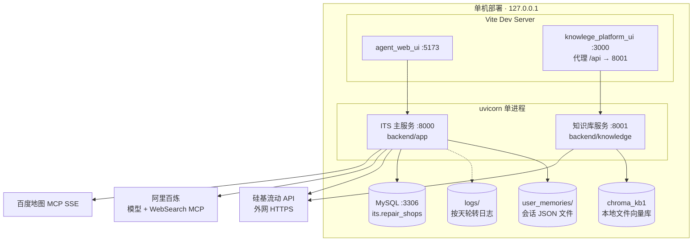
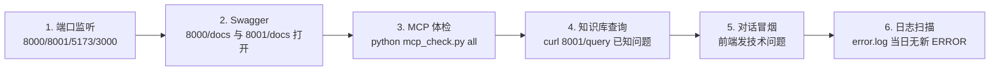
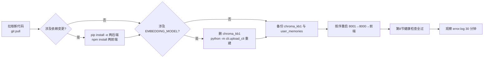

# 4_运维文档（ITS 多智能体系统）

> 编写视角：资深运维工程师
> 更新时间：2026-11-04
> 读者对象：运维/DevOps 工程师、部署实施人员、值班支持
> 适用环境：本地/内网演示环境（Windows），可平移至 Linux（注意路径与进程守护方式）

---

## 目录

1. [部署架构与服务清单](#1-部署架构与服务清单)
2. [环境要求与外部依赖](#2-环境要求与外部依赖)
3. [首次部署手册](#3-首次部署手册)
4. [日常启停操作手册](#4-日常启停操作手册)
5. [配置管理](#5-配置管理)
6. [日志管理](#6-日志管理)
7. [数据管理与备份恢复](#7-数据管理与备份恢复)
8. [健康检查与监控](#8-健康检查与监控)
9. [常见故障排查手册（Runbook）](#9-常见故障排查手册runbook)
10. [安全加固清单](#10-安全加固清单)
11. [升级发布流程](#11-升级发布流程)

---

## 1. 部署架构与服务清单



### 服务清单与启动顺序

| 顺序 | 服务 | 目录 | 端口 | 启动命令（在对应目录执行） | 依赖 |
|---|---|---|---|---|---|
| 1 | 知识库服务 | `backend/knowledge` | 8001 | `python -m api.main` | .env、chroma_kb1、外网（嵌入调用） |
| 2 | ITS 主服务 | `backend/app` | 8000 | `python -m api.main` | 8001 就绪、.env、MySQL（可缺库启动）、MCP 外网 |
| 3 | 知识库前端 | `front/knowlege_platform_ui` | 3000 | `npm install && npm run dev` | 8001 |
| 4 | 对话前端 | `front/agent_web_ui` | 5173 | `npm install && npm run dev` | 8000 |

> ⚠️ 严格按序启动：主服务的 `query_knowledge` 工具经 HTTP 调用 8001，顺序颠倒会出现首轮知识库查询失败（服务可自愈，但建议保证顺序）。

---

## 2. 环境要求与外部依赖

### 2.1 本机环境

| 项 | 要求 | 说明 |
|---|---|---|
| Python | ≥3.10 | 当前环境使用 Anaconda：`D:\devEnv\12_anaconda\python.exe` |
| Node.js | ≥18（Vite 5） | 两个前端各自 `npm install` |
| MySQL | 5.7+/8.0 | 仅门店查询需要；**当前环境已建库且可正常访问** |
| 磁盘 | ≥1 GB | chroma_kb1≈17MB、crawl≈735 篇 md、日志按天增长 |

### 2.2 外部服务与账号（缺一对应的降级表现）

| 依赖 | 配置项 | 用途 | 缺失/失效时表现 |
|---|---|---|---|
| 硅基流动 | `SF_API_KEY/SF_BASE_URL` | 主调度模型 +（知识库服务）生成/嵌入 | 8000 启动直接失败（settings 校验）；8001 查询/上传报错 |
| 阿里百炼 | `AL_BAILIAN_API_KEY/AL_BAILIAN_BASE_URL` | 两个子智能体模型（qwen3-max） | 技术问答/门店问答返回错误文案 |
| 百炼 WebSearch MCP | `DASHSCOPE_BASE_URL`（**必须 /mcp 端点**）+ `DASHSCOPE_API_KEY` | 联网搜索 | 启动仅告警；实时资讯类问题失败 |
| 百度地图 MCP | `BAIDUMAP_AK` | 定位/POI/导航链接 | 启动仅告警；门店导航失败 |
| MySQL | `MYSQL_*` | 门店库 | 服务可启动；门店类问题返回"数据库查询失败" |

> 额度提醒：硅基流动/百炼按量计费，联网搜索 MCP 使用独立 key（与子模型 key 解耦）；建议在云控制台配置余额告警。

---

## 3. 首次部署手册

### Step 1：获取代码与依赖

```bash
cd its_multi_agent

# 后端依赖（二选一：setup.py 安装或手动 pip）
pip install -e backend/app
pip install -e backend/knowledge
# 测试工具（可选）
pip install pytest pytest-asyncio httpx

# 前端依赖
cd front/agent_web_ui && npm install && cd ../..
cd front/knowlege_platform_ui && npm install && cd ../..
```

### Step 2：配置密钥

```bash
copy backend\app\.env.example backend\app\.env
copy backend\knowledge\.env.example backend\knowledge\.env
# 编辑两个 .env，填入真实 Key（红线：.env 绝不入库）
```

配置项对照见第 5 节。**校验点**：`DASHSCOPE_BASE_URL` 必须是 `https://dashscope.aliyuncs.com/api/v1/mcps/WebSearch/mcp`（`/sse` 已被阿里下线，配错则搜索全部失败）。

### Step 3：初始化知识库数据（首次必做）

向量库与知识文档已被 gitignore，全新环境需要重建：

```bash
cd backend\knowledge
# 3.1 爬取知识文档（约 1000 号，实际产出 735 篇；若已有 data/crawl 可跳过）
python -m cli.crawl_cli
# 3.2 全量向量化入库（batch=16，带 tqdm 进度与总耗时输出）
python -m cli.upload_cli
```

产物校验：`chroma_kb1/` 出现 sqlite/chroma 文件；`upload_cli` 末行输出"最终入库成功的结果:成功:xxx--->失败:0"。

### Step 4：MySQL 门店库确认（门店功能必需）

> ✅ 当前环境：`its` 库与 `repair_shops` 表**已建立并可正常访问**（2026-11-05 确认），门店查询/导航链路完整可用。
> 运维要点：纳入第 7 节的 mysqldump 例行备份；**全新环境重建时**仓库不含建表 SQL，可按开发文档 8.1 节字段清单自建 `repair_shops` 表（含 latitude/longitude 数值列）并导入门店数据，未建库不影响其他功能（仅门店类问题返回错误文案）。

```sql
-- 健康验证：确认门店数据可查（应返回门店行数）
SELECT COUNT(*) FROM its.repair_shops;
-- 全新环境建库参考（字段清单见 2_开发文档 8.1）：
-- CREATE DATABASE IF NOT EXISTS its DEFAULT CHARSET utf8mb4;
```

### Step 5：按序启动并验证

按第 4 节启动 4 个服务，随后执行第 8 节健康检查全部通过即部署完成。

---

## 4. 日常启停操作手册

### 启动（每次开机/发布后）

```bash
# 终端1
cd backend\knowledge  && D:\devEnv\12_anaconda\python.exe -m api.main
# 终端2（等 8001 就绪）
cd backend\app        && D:\devEnv\12_anaconda\python.exe -m api.main
# 终端3/4
cd front\knowlege_platform_ui && npm run dev
cd front\agent_web_ui          && npm run dev
```

### 停止

- 开发环境：各终端 `Ctrl+C`。主服务停止时会触发 lifespan 的 `mcp_cleanup()` 释放 MCP 连接（日志可见"MCP连接清理完成"）。
- 强杀（异常时）：按端口找 PID 后 `taskkill /PID <pid> /F`：

```powershell
Get-NetTCPConnection -LocalPort 8000,8001,5173,3000 -State Listen |
  Select-Object LocalPort, OwningProcess
```

### 重启单个服务

知识库服务重启后，主服务**无需重启**（HTTP 调用无长连接）；主服务重启会重新建立 MCP 连接（数秒）。

---

## 5. 配置管理

### 5.1 配置文件清单

| 文件 | 用途 | 变更生效方式 |
|---|---|---|
| `backend/app/.env` | 主服务全部配置 | **重启主服务** |
| `backend/knowledge/.env` | 知识库服务配置 | **重启知识库服务**；改 `EMBEDDING_MODEL` 还需重建向量库 |
| `front/knowlege_platform_ui/vite.config.js` | 3000 端口与 /api 代理目标 | 重启前端 dev server |
| `front/agent_web_ui/src/App.vue` | ⚠️ 后端地址 `http://127.0.0.1:8000` 硬编码在前端代码中 | 改代码后 Vite 热更新；换主机部署必须修改 |

### 5.2 主服务 .env 完整项

| 变量 | 默认/示例 | 备注 |
|---|---|---|
| SF_API_KEY / SF_BASE_URL | `https://api.siliconflow.cn/v1` | 必填（否则启动失败） |
| MAIN_MODEL_NAME | `Qwen/Qwen3-32B` | |
| AL_BAILIAN_API_KEY / AL_BAILIAN_BASE_URL | `https://dashscope.aliyuncs.com/compatible-mode/v1` | 与硅基流动至少配一组 |
| SUB_MODEL_NAME | `qwen3-max` | |
| MYSQL_HOST/PORT/USER/PASSWORD/DATABASE | localhost/3306/root/*/its | 库名注意：settings 默认 `its_db`，example 模板为 `its`，以 .env 实际为准 |
| MYSQL_CHARSET / CONNECT_TIMEOUT / MAX_CONNECTIONS | utf8mb4 / 10 / 5 | 连接池上限 5，压测时关注 |
| DASHSCOPE_BASE_URL | `…/WebSearch/mcp` | **必须 /mcp** |
| DASHSCOPE_API_KEY | — | 搜索专用，独立计费 |
| BAIDUMAP_AK | — | 百度地图开放平台申请 |
| KNOWLEDGE_BASE_URL | `http://127.0.0.1:8001` | 指向知识库服务 |

### 5.3 密钥红线（摘自 readme，运维必须遵守）

- 任何密钥（`sk-` 开头 / AK / 数据库密码）**不得**出现在代码、文档、日志、聊天记录中，只允许存在于被 `.gitignore` 排除的 `.env`；
- 排查问题时对外提供的日志片段需先脱敏（日志本身不含密钥，但注意终端回显）；
- 泄露应急：立即在对应云平台吊销 Key → 更换 `.env` → 重启服务。

---

## 6. 日志管理

### 6.1 日志布局（`backend/app/logs/`，启动自动创建）

| 文件 | 级别 | 轮转 | 保留 | 用途 |
|---|---|---|---|---|
| `app.log` | INFO+ | 每天午夜 | 30 天 | 日常运行审计（请求、路由、工具调用） |
| `error.log` | ERROR+ | 每天 | 60 天 | 告警来源，值班优先看 |
| `agent_debug.log` | DEBUG+ | 每天 | 7 天 | Agent 思考/工具全链路追踪（体积大，短保留） |

控制台另有彩色输出（INFO 以上，仅屏幕不落盘）。格式：

```
%(asctime)s | %(levelname)-8s | %(name)s:%(lineno)d | %(message)s
```

### 6.2 关键日志关键字（排障索引）

| 关键字 | 含义 | 出现时动作 |
|---|---|---|
| `应用启动，建立MCP连接...` / `MCP连接建立完成` | 主服务生命周期正常 | — |
| `百度地图MCP连接失败` / `搜索MCP连接失败` | 对应 MCP 不可用 | 查 AK/网络；见 Runbook R4 |
| `[Route] 转交技术专家` / `[Route] 转交业务专家` | 调度发生 | 定位"答非所问"时核对路由 |
| `[Location] ... fallback` | 定位走了北京兜底 | 核对 geocode/IP 失败原因（上一行 warning） |
| `[NearestShops] DB query failed` | 门店 SQL 失败 | 查 MySQL（常见：库不存在） |
| `发送请求获取知识库服务下的知识库数据失败` | 8000→8001 调用失败 | 检查 8001 是否存活 |
| `保存用户 ... 会话 ... 文件失败` | 会话落盘失败 | 检查磁盘/权限 |

> 知识库服务（8001）使用 logging 标准输出（basicConfig），未落文件；需要留存时建议以 `nohup`/重定向方式启动并收集 stdout（Linux）或改造成与主服务一致的 TimedRotatingFileHandler（改造建议见升级流程）。

---

## 7. 数据管理与备份恢复

| 数据 | 路径 | 备份建议 | 恢复方式 |
|---|---|---|---|
| 知识文档 | `backend/knowledge/data/crawl/`（735 篇） | 随任何变更备份一次（增量低频） | 重跑 `python -m cli.crawl_cli` 可重建（目标站可用时） |
| 向量库 | `backend/knowledge/chroma_kb1/`（≈17MB） | **每次知识入库后备份**（损坏隔离副本） | 删除目录 → `python -m cli.upload_cli` 全量重建（约数分钟，见 upload_cli 计时输出） |
| 会话记忆 | `backend/app/user_memories/` | 用户数据，纳入定期备份；**按用户/日期清理防膨胀** | 不可重建，只能恢复备份 |
| 日志 | `backend/app/logs/` | 无需备份（自动轮转清理） | — |
| MySQL | `its` 库 | mysqldump 例行备份 | 标准流程 |

**chroma_kb1 常见操作**：

```bash
# 备份
cp -r backend/knowledge/chroma_kb1 backend/knowledge/chroma_kb1_bak_$(date +%F)
# 损坏重建（更换 Embedding 模型后必须执行）
rm -rf backend/knowledge/chroma_kb1 && python -m cli.upload_cli
```

**user_memories 清理策略建议**：按文件修改时间保留最近 90 天；单用户会话数无上限（当前实现），异常增长时人工排查（前端新建会话会持续产生 JSON）。

---

## 8. 健康检查与监控

### 8.1 人工巡检（当前无自动化监控，按此清单执行）



参考命令：

```powershell
# 端口
Get-NetTCPConnection -LocalPort 8000,8001 -State Listen | Select LocalPort,OwningProcess
# 知识库探活
curl http://127.0.0.1:8001/docs -UseBasicParsing
# 知识库业务探活
curl -X POST http://127.0.0.1:8001/query -H "Content-Type: application/json" `
     -d '{"question":"电脑开机之后无任何反应怎么办"}'
# MCP 体检（search/baidu/all）
cd backend\app && python mcp_check.py all
```

### 8.2 建议的监控项（建设方向）

| 项 | 建议 | 阈值建议 |
|---|---|---|
| 进程/端口探活 | 8000、8001 每分钟 TCP 探测 | 失败 2 次告警 |
| 业务拨测 | 定时 POST /query 固定问题，断言 answer 非空 | 失败或 P95>30s 告警 |
| 错误日志 | tail error.log 新增 ERROR | 关键字告警（MCP/DB） |
| 外部额度 | 硅基流动/百炼余额 | 低于阈值告警（云控制台配置） |
| 磁盘 | logs/ 与 user_memories/ 容量 | >80% 告警 |

---

## 9. 常见故障排查手册（Runbook）

| 编号 | 现象 | 可能原因 | 处置步骤 |
|---|---|---|---|
| R1 | 8000 启动即抛 `必须配置至少一个 AI 服务` | .env 缺失或未填 SF/Bailian | 对照 .env.example 补齐 → 重启 |
| R2 | 端口被占用（`Address already in use`） | 上次进程未退出 | 第 4 节命令找 PID → taskkill → 重启 |
| R3 | 技术问答报"Server not initialized" | 搜索 MCP 连接失败（key 失效/URL 误配 /sse） | 核对 DASHSCOPE_BASE_URL 必须为 `/mcp`；`python mcp_check.py search` 验证；必要时临时摘除 technical_agent 的 `mcp_servers=[search_mcp_client]`（代码注释有预警） |
| R4 | 百度地图相关全部失败 | AK 无效/欠费/网络 | `python mcp_check.py baidu`；检查 BAIDUMAP_AK |
| R5 | 门店查询返回"数据库查询失败" | MySQL 服务未启动 / 连接配置错误 / 连接池耗尽 | 检查 MySQL 服务与 .env（库名 its）；`SELECT COUNT(*) FROM its.repair_shops` 验证数据；连接池耗尽时查并发与慢查询 |
| R6 | 知识库回答始终"未检索到" | chroma_kb1 缺失/为空；crawl 目录缺失 | 检查两目录；重建数据（第 3 节 Step 3） |
| R7 | 知识库回答明显变差 | 更换过 EMBEDDING_MODEL 未重建向量库 | 重建 chroma_kb1；跑检索评测集对比 |
| R8 | 8000→8001 调用失败日志 | 8001 未启动/重启中 | 先起 8001；确认 KNOWLEDGE_BASE_URL |
| R9 | 前端请求报 CORS/网络错误 | 8000 未启动；或非本机部署但 App.vue 地址未改 | 起服务；改前端后端地址常量 |
| R10 | 会话列表为空/回看失败 | user_memories 目录被清；单个 JSON 损坏 | 损坏文件会在列表中带 error 字段，删除该文件即可恢复其余 |
| R11 | 回答中出现重复知识条目 | 同一文档重复上传入库（BUG-02） | 重建向量库；等 /upload 去重修复 |
| R12 | 上传大文件 500/超时 | 嵌入调用慢或文件异常 | 查看 8001 控制台栈；改小文件验证；必要时重启 8001 |

---

## 10. 安全加固清单

> 当前定位为内网/本机演示环境，**公网暴露前必须完成下表"公网必做"项**。

| 项 | 现状 | 风险 | 级别 |
|---|---|---|---|
| CORS `allow_origins=["*"]`（8000） | 全开 | 恶意站点可带凭证跨域调用 | 公网必做：改白名单 |
| 服务绑定 `127.0.0.1` | 仅本机可访问 | （同时也是保护） | 公网部署改 `0.0.0.0` 时必须配网关鉴权 |
| 前端演示账号硬编码（root1-3/123456） | 无后端鉴权 | 冒用 user_id 即可读写他人会话 | 公网必做：接真实登录+服务端鉴权 |
| /upload 无文件类型/大小限制 | 任意文件可传 | 磁盘滥用、异常文件 | 建议加白名单(.md/.txt)与大小上限 |
| 会话数据未脱敏 | 明文 JSON | 用户输入含敏感信息的合规风险 | 按需脱敏/加密 |
| 密钥管理 | .env + gitignore（已治理） | 迁移至密钥管理服务更佳 | 建议 |
| 依赖漏洞 | 未扫描 | — | 建议 `pip audit` / `npm audit` 例行执行 |

---

## 11. 升级发布流程



**回滚**：git 回退版本 → 恢复 chroma_kb1 备份 → 重启。会话数据升级前后天然兼容（JSON 结构未变更时）。

**改造建议（运维侧 backlog）**：
1. 8001 日志改造为与 8000 一致的按天轮转文件；
2. 编写 `start_all.ps1` / systemd unit 一键拉起 4 服务并守护；
3. /api/query 增加网关层限流（当前无任何限流）；
4. App.vue 后端地址抽成 Vite 环境变量（`VITE_API_BASE`）。

---

## 关联文档

- [1_产品文档](1_产品文档.md) ｜ [2_开发文档](2_开发文档.md) ｜ [3_测试文档](3_测试文档.md) ｜ [5_学习文档](5_学习文档.md)
