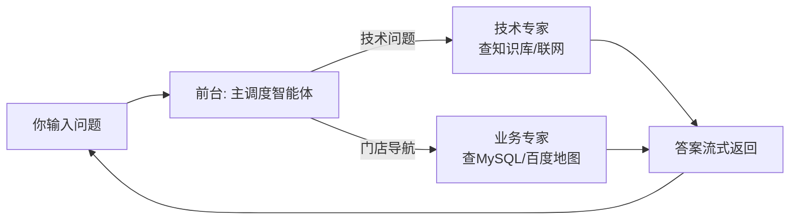
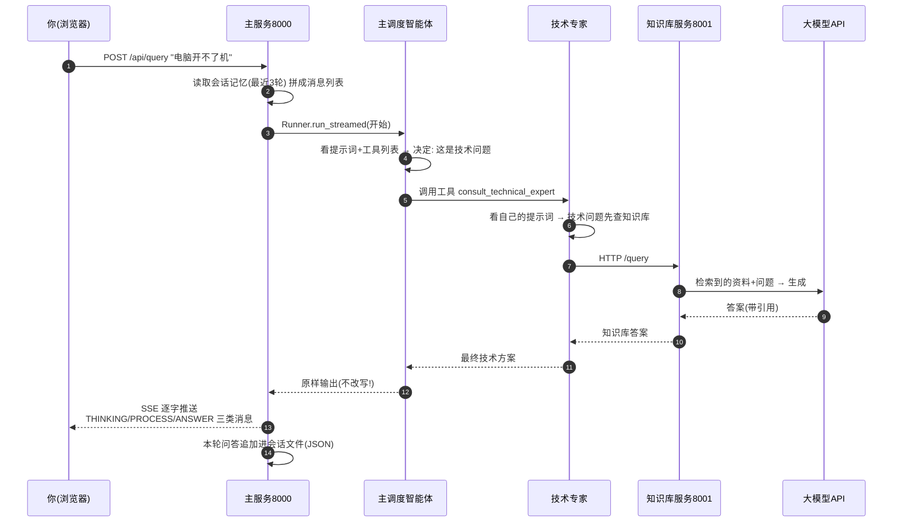
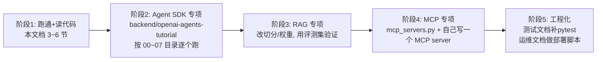

# 5_学习文档（新人快速上手指南）

> 编写视角：写给第一次接触本项目的你
> 更新时间：2026-11-04
> 目标：**30 分钟跑起来 → 2 小时看懂架构 → 1 天能改代码**
> 前置要求：会基本的 Python 和命令行操作即可，不要求懂大模型原理

---

## 目录

1. [这个项目是做什么的？（大白话版）](#1-这个项目是做什么的大白话版)
2. [先补 6 个概念（5 分钟）](#2-先补-6-个概念5-分钟)
3. [第一步：把它跑起来（30 分钟）](#3-第一步把它跑起来30-分钟)
4. [第二步：看懂全局地图](#4-第二步看懂全局地图)
5. [第三步：跟着一次对话读代码](#5-第三步跟着一次对话读代码)
6. [概念 → 代码位置对照表](#6-概念--代码位置对照表)
7. [动手练习（由易到难）](#7-动手练习由易到难)
8. [新人常踩的 10 个坑](#8-新人常踩的-10-个坑)
9. [进阶学习路线](#9-进阶学习路线)

---

## 1. 这个项目是做什么的大白话版

想象一家维修公司的客服：

- 你打电话说"电脑开不了机"，**前台**（主调度智能体）听懂这是技术问题，转接**技术专家**；
- 你说"附近哪有维修店"，前台转接**门店专员**（全能业务智能体），他会查数据库和地图；
- 你说"顺便查下今天天气"，前台还能把多个事**一件件办完**，再把结果**按顺序**告诉你。

这个项目就是把这套流程用大模型实现出来，而且：

- 技术专家回答问题**不是瞎编**的——他先去公司知识库（735 篇联想售后文档做成向量库）里查资料，查不到才上网搜；
- 所有回答都是**一个字一个字蹦出来**的（流式/SSE），体验像 ChatGPT。

项目一共 4 个程序：2 个 Python 后端（多智能体服务 :8000、知识库服务 :8001）+ 2 个 Vue 前端（聊天 :5173、知识库管理 :3000）。



---

## 2. 先补 6 个概念（5 分钟）

| 概念 | 一句话解释 | 在本项目中的样子 |
|---|---|---|
| **Agent（智能体）** | 一个带"角色说明书"（提示词）+ 一堆工具的大模型实例 | 代码里的 `Agent(name=..., instructions=..., tools=...)` |
| **Function Tool（工具）** | 给大模型提供的"函数"，模型自己决定什么时候调 | `@function_tool` 装饰的 Python 函数，比如"查知识库" |
| **MCP** | 把外部服务变成工具的通用协议（模型上下文协议） | 联网搜索（阿里百炼）、百度地图，都是通过 MCP 接进来的 |
| **RAG（检索增强生成）** | 先从资料库里"找资料"，再把资料喂给模型"照着答" | 知识库服务的检索管线 + 生成提示词 |
| **Embedding（向量化）** | 把文字变成一串数字（向量），文字越相似数字越接近 | `BAAI/bge-m3` 模型，1024 维，存进 Chroma 向量库 |
| **SSE** | 服务器往浏览器"持续推送文字"的 HTTP 技巧 | `/api/query` 返回 `text/event-stream`，前端逐字渲染 |

> 再加一个高频词：**Agent-as-Tool**——把"技术专家"整个智能体包装成一个工具给"前台"用。这就是本项目多智能体协作的方式（不是 handoff 交接，而是主调度调用子智能体工具）。

---

## 3. 第一步把它跑起来（30 分钟）

### 3.1 准备清单

- [ ] Python ≥3.10（本项目开发用的是 `D:\devEnv\12_anaconda\python.exe`，换成你自己的也行）
- [ ] Node.js ≥18
- [ ] 两个 API Key：**硅基流动**（`sk-`，模型+向量用）和 **阿里百炼**（qwen3-max + 联网搜索用）
- [ ] 一个**百度地图 AK**（开放平台免费申请）
- [ ] MySQL（当前环境已就绪，门店查询用；仅全新环境部署时才需自行建库）

### 3.2 五步走

```bash
# ① 装后端依赖（两个服务各一次）
cd backend/app        && pip install -e .
cd ../knowledge       && pip install -e .

# ② 配置密钥（把模板复制成 .env，填入你的 Key）
copy .env.example .env       # 在 backend/app 和 backend/knowledge 各做一次
# ★ 必查项：backend/app/.env 里 DASHSCOPE_BASE_URL 必须以 /mcp 结尾
#   （阿里已下线 /sse 端点，配错搜索必挂——这是新人第一大坑）

# ③ 建知识库数据（如果仓库里没有 chroma_kb1 和 data/crawl 才需要）
python -m cli.crawl_cli      # 爬 735 篇文档（有 data/crawl 可跳过）
python -m cli.upload_cli     # 全部向量化入库（几分钟，有进度条）

# ④ 按顺序启动！先 8001 再 8000
python -m api.main           # 终端1，在 backend/knowledge 下 → 8001
python -m api.main           # 终端2，在 backend/app 下 → 8000

# ⑤ 前端（终端3、4）
cd front/agent_web_ui        && npm install && npm run dev   → http://localhost:5173
cd front/knowlege_platform_ui && npm install && npm run dev  → http://localhost:3000
```

### 3.3 验证跑通了

1. 打开 `http://127.0.0.1:8001/docs` 和 `http://127.0.0.1:8000/docs` —— 都能看到 Swagger 页面；
2. 打开 `http://localhost:5173`，登录（测试账号 `root1` / `123456`）；
3. 发一句：**"电脑开机之后无任何反应怎么办"** → 能看到"思考中…→ 调用工具卡片 → 答案逐字出现"，且答案带步骤列表，就是成功了；
4. 再发 **"今天北京天气怎么样"** → 答案开头应有"以下信息来自网络搜索…"；
5. 发 **"帮我找个最近的维修站"** → 返回 Top3 门店和导航链接（门店库已就绪，可直接验证）。

### 3.4 跑不起来的急救顺序

报什么 → 翻 [4_运维文档 第 9 节 Runbook](4_运维文档.md)，最常见的三个：
1. **启动秒退**提示"必须配置至少一个 AI 服务" → .env 没填好；
2. **搜不到/联网失败** → DASHSCOPE_BASE_URL 用了 `/sse`，改成 `/mcp`；
3. **知识库答非所问/查不到** → chroma_kb1 没建，跑第③步。

---

## 4. 第二步看懂全局地图

### 4.1 目录地图（记住 ★ 的就够了）

```
its_multi_agent/
├── backend/
│   ├── app/                    ★ 主服务(8000)：多智能体全在这
│   │   ├── api/                ★   路由入口（/api/query SSE）
│   │   ├── multi_agent/        ★★  三个智能体 + 工厂（核心！）
│   │   ├── prompts/            ★★  三个智能体的"角色说明书"
│   │   ├── services/           ★   编排、会话记忆、SSE 转换
│   │   ├── infrastructure/     ★   工具(查库/门店)、MCP客户端、日志、DB池
│   │   ├── schemas/            请求/响应模型（SSE 协议长啥样）
│   │   ├── repositories/       会话存成 JSON 文件的读写
│   │   └── prompts/ user_memories/ logs/   提示词/记忆/日志
│   └── knowledge/              ★ 知识库服务(8001)：RAG 全在这
│       ├── services/retrieval_service.py  ★★ 检索管线（最值得精读）
│       ├── services/query_service.py      生成答案的提示词
│       ├── services/ingestion/            文档切分入库
│       ├── services/crawler/              爬虫（怎么搞到735篇文档）
│       ├── cli/                           命令行：爬取/入库
│       └── chroma_kb1/ data/crawl/        向量库 + 原始文档
└── front/
    ├── agent_web_ui/src/App.vue      ★ 聊天前端（一个1832行的组件全包了）
    └── knowlege_platform_ui/src/     知识库管理前端
```

### 4.2 一次提问的完整旅程（背下这张图）



三个最容易迷惑的点，先说破：

1. **为什么答案是"原样输出"不能改写？** 主调度的提示词（`prompts/orchestrator_v1.md`）反复强调：调度员只负责"识别+转交+拼接"，一旦让它自由发挥就会丢结果、加戏。这是多任务不丢段的关键。
2. **会话记忆怎么实现的？** 很朴素：每次对话把消息列表存成 `user_memories/{用户}/{会话}.json`，下次发问前读出来、只留最近 3 轮，拼在请求里。
3. **知识库为什么查两遍？** 检索分"向量语义"和"标题关键词"两路（互相补盲区），合并去重后再精挑 2 篇最好的给模型。

---

## 5. 第三步跟着一次对话读代码

推荐精读顺序（每处都不长，总共 1~2 小时）：

| 步骤 | 文件 | 看什么 |
|---|---|---|
| ① | `backend/app/api/routers.py` | 请求进来 → 返回 `StreamingResponse`（SSE 起点） |
| ② | `backend/app/services/agent_service.py` | **全链路编排**：备历史→跑流→存历史→失败重试一次（80 行，本项目最核心的文件之一） |
| ③ | `backend/app/multi_agent/orchestrator_agent.py` | 主调度怎么定义（就 20 行配置） |
| ④ | `backend/app/prompts/orchestrator_v1.md` | ★★ 提示词=调度员的"岗位职责书"，多智能体效果好不好一大半看它 |
| ⑤ | `backend/app/multi_agent/agent_factory.py` | Agent-as-Tool：子智能体怎么变成工具 |
| ⑥ | `backend/app/prompts/technical_agent.md` | 技术专家的"分流规则"（实时→联网；技术→知识库） |
| ⑦ | `backend/app/services/stream_response_service.py` | SDK 事件 → SSE 包的翻译器 |
| ⑧ | `backend/app/schemas/response.py` | SSE 协议数据结构（kind=THINKING/PROCESS/ANSWER） |
| ⑨ | `backend/app/infrastructure/tools/local/service_station.py` | 定位三级降级 + Haversine 门店 SQL |
| ⑩ | `backend/knowledge/services/retrieval_service.py` | ★★ RAG 检索管线（粗排/精排/重排全在这，309 行） |
| ⑪ | `front/agent_web_ui/src/App.vue` 搜 `processSSEData` | 前端怎么逐行解析 SSE |

> 读 ② 时注意一个小设计：`prepare_history` 只保留最近 3 轮（`_truncate_history`），防止历史太长撑爆上下文——这是最简单的"记忆管理"。

---

## 6. 概念 → 代码位置对照表

| 你想搞懂的概念 | 去看这个文件 | 关键行/函数 |
|---|---|---|
| 多智能体怎么定义 | `backend/app/multi_agent/orchestrator_agent.py` | `orchestrator_agent = Agent(...)` |
| 智能体互相调用 | `backend/app/multi_agent/agent_factory.py` | `@function_tool consult_technical_expert` |
| 提示词工程 | `backend/app/prompts/*.md` | 三个 md 全读 |
| MCP 接入（HTTP/SSE 两种） | `backend/app/infrastructure/tools/mcp/mcp_servers.py` | `MCPServerStreamableHttp` / `MCPServerSse` |
| MCP 生命周期 | `backend/app/api/main.py` | `lifespan` 里 connect/cleanup |
| 自定义工具 | `backend/app/infrastructure/tools/local/knowledge_base.py` | `@function_tool query_knowledge`（最简单的范例） |
| RAG 入库（切分） | `backend/knowledge/services/ingestion/ingestion_processor.py` | `ingest_file()` |
| RAG 检索（排序） | `backend/knowledge/services/retrieval_service.py` | `rough_ranking / fine_ranking / retrieval` |
| RAG 生成（防幻觉提示词） | `backend/knowledge/services/query_service.py` | `generate_answer()` 里的大 prompt |
| 会话记忆 | `backend/app/services/session_service.py` | `prepare_history / _truncate_history` |
| SSE 协议 | `backend/app/schemas/response.py` + `utils/response_util.py` | `StreamPacket / ResponseFactory` |
| 流式事件翻译 | `backend/app/services/stream_response_service.py` | `process_stream_response()` |
| 数据库连接池 | `backend/app/infrastructure/database/database_pool.py` | `PooledDB` 单例 |
| 日志轮转 | `backend/app/infrastructure/logging/logger.py` | 三个 `TimedRotatingFileHandler` |
| 爬虫 | `backend/knowledge/cli/crawl_cli.py` + `services/crawler/` | 抓取→解析→存 md 全流程 |
| 前端 SSE 解析 | `front/agent_web_ui/src/App.vue` | 搜 `processSSEData`、`getReader` |

---

## 7. 动手练习由易到难

> 每个练习都标了预计用时。改完重启对应服务即可看到效果。

### 练习 1（10 分钟）：给技术专家"加一条规矩"
打开 `backend/app/prompts/technical_agent.md`，在"关键约束"里加一条，比如：
> 5. **回答长度**：操作步骤超过 8 步时，先给"快速自查三步"，再给完整步骤。
重启 8000，用"重装系统"类问题验证效果。**体会：改 Agent 行为，第一入口是提示词。**

### 练习 2（15 分钟）：换一个模型试试
把 `backend/app/.env` 的 `SUB_MODEL_NAME` 从 `qwen3-max` 改成另一个兼容 OpenAI 协议的模型名（确保 key 支持），重启，对比同一个问题的回答质量。**体会：模型配置与代码解耦。**

### 练习 3（30 分钟）：上传一篇自己的知识
准备一个 md（比如《公司打印机使用指南》），从知识库前端（:3000）上传，然后回 :5173 提问里面的内容。再看 `upload` 返回的 `chunks_added`。**体会：RAG 数据闭环。**（思考题：同一篇传两次会怎样？——会重复入库，这是个已知待修复点）

### 练习 4（1 小时）：给业务专家加一个新工具
参照 `query_nearest_repair_shops_by_coords` 的写法，在 `infrastructure/tools/local/` 新增一个工具，比如 `query_repair_shops_by_city(city)`（按城市查询门店），docstring 写清"何时该调用你"，挂到 `comprehensive_service_agent.tools`，更新 `TOOL_NAME_MAPPING` 让前端显示中文名。**体会：给 Agent 添能力的标准四步。**

### 练习 5（2 小时，进阶）：给主调度加第三个专家
做一个"闲聊陪伴专家"：新建 `prompts/casual_agent.md`（定义它只负责寒暄、情绪安抚），新建 `multi_agent/casual_agent.py`，在 `agent_factory.py` 里包成工具 `casual_chat` 并加入 `AGENT_TOOLS`，最后**在 orchestrator_v1.md 的"可用工具"和示例里写清何时用它**（这步不做，调度员基本不会用它）。测试："我今天心情不好"应路由到新专家。**体会：扩一个业务域的完整流程；提示词决定调度。**

### 练习 6（半天，挑战）：跑通检索评测
按 [3_测试文档 第 7.2 节](3_测试文档.md) 从 crawl 目录选 30 篇文档写"问题→应命中标题"清单，写脚本算 hit@2；然后试着把粗排权重 0.7 调成 0.6，看指标涨还是跌。**体会：RAG 调参要用数据说话。**

---

## 8. 新人常踩的 10 个坑

| # | 坑 | 说明/解法 |
|---|---|---|
| 1 | `DASHSCOPE_BASE_URL` 配成 `/sse` | 阿里已下线 sse 端点，**必须 `/mcp`**；症状：所有联网搜索失败"Server not initialized" |
| 2 | 启动顺序颠倒 | 先 8000 后 8001 → 首轮知识库查询失败；记住"先知识库，后主服务" |
| 3 | 改了提示词没重启 | 提示词是启动时加载进内存的（`load_prompt`），改完必须重启 8000 |
| 4 | 换了 Embedding 模型没重建向量库 | 新旧向量维度/空间不兼容，检索效果崩；删 `chroma_kb1` 重跑 `upload_cli` |
| 5 | 直接运行 `multi_agent/xxx.py` 报 ModuleNotFoundError | 各文件已内置 `sys.path` 自举；用 `python -m multi_agent.technical_agent` 或 IDE 里以 app 为工作目录运行 |
| 6 | 门店查询报错 | 多为 MySQL 服务没启动或 .env 连接配置不对；全新环境才需自建 repair_shops 表（字段清单见开发文档 8.1） |
| 7 | 前端页面打不开后端 | App.vue 里后端地址硬编码 `127.0.0.1:8000`，换机器/换端口要改代码 |
| 8 | 重复上传同一文档 | /upload 没有去重（已知问题），向量库里会出现重复条目影响检索 |
| 9 | 会话"失忆" | session_id 为空会落到 `default_session`；新建会话才隔离上下文；侧边栏点会话可回看 |
| 10 | 以为答案错了是代码 bug | LLM 有随机性；先确认"路由对不对"（看过程卡片调用了哪个工具），再看"内容对不对"，排查思路见 [3_测试文档](3_测试文档.md) |

---

## 9. 进阶学习路线

### 9.1 推荐学习顺序（结合本项目）



- `backend/openai-agents-tutorial/` 是配套的 Agents SDK 练习册（60 个文件按主题分目录：模型接入/工具/会话/流式/MCP/多智能体），**每个示例都能独立运行**，是这个仓库里最好的自学材料；
- 读 SDK 官方文档关键词：`openai-agents`（Agent / Runner / function_tool / MCPServer / Streaming）。

### 9.2 每个主题的"必答三问"（自测是否学会）

| 主题 | 自测问题 |
|---|---|
| 多智能体 | 为什么主调度要求"原样输出"？如果让它自由总结会出什么事故？ |
| 工具 | docstring 为什么那么重要？谁来"读"它？ |
| MCP | 本项目两种 MCP 传输分别是什么？为什么搜索必须用 streamable-HTTP？ |
| RAG | 为什么检索要两路？粗排为什么用 jieba 词匹配加权而不只用字符？ |
| 会话 | 裁剪历史为什么不裁 system 消息？只留 3 轮的利弊？ |
| SSE | ANSWER/THINKING/PROCESS 三类包分别驱动前端哪个 UI？ |

### 9.3 仓库内其他文档

- [1_产品文档](1_产品文档.md)：懂"为什么做"（用户/场景/数据资产）
- [2_开发文档](2_开发文档.md)：懂"怎么实现的"（架构/统计/接口/协议）
- [3_测试文档](3_测试文档.md)：懂"怎么验证"（用例与评测方法）
- [4_运维文档](4_运维文档.md)：懂"怎么部署维护"（Runbook 很实用）

> 最后一条建议：**跑起来之后，把"一次提问的完整旅程"那张时序图对照日志（`logs/agent_debug.log`）走一遍**，你会对整条链路有肌肉记忆。祝上手顺利！
