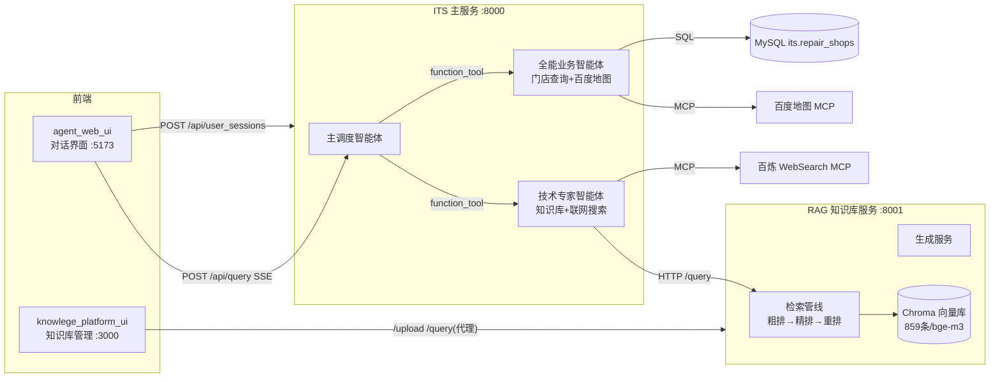

# ITS 多智能体项目（README）

> 更新时间：2026-09-27 ｜ 基于代码仓库实际结构整理
> 配套文档：[产品文档](mydocs/02-产品文档.md) ｜ [开发文档](mydocs/03-开发文档.md) ｜ [综合学习文档](mydocs/04-综合学习文档.md)

## 1. 项目简介

**ITS（Intelligent Technical Support）多智能体** 是一个基于大模型的智能技术支持/售后客服系统。它模拟真实企业的「客服调度 → 专业分工」模式：

- 一个 **主调度智能体**（Orchestrator）接收用户任意问题
- 按问题类型转交给 **技术专家智能体**（查知识库/联网搜索）或 **全能业务智能体**（查维修门店/地图服务）
- 以 **SSE 流式**方式把结果实时推回前端对话界面

项目由 **2 个后端服务 + 2 个前端应用** 组成，是一个完整的、可本地运行的全栈 AI 应用。

## 2. 技术栈总览

| 层 | 技术 | 用途 |
|---|---|---|
| LLM 编排 | OpenAI Agents SDK（`openai-agents 0.20.0`） | 多智能体、function tool、MCP、流式事件 |
| LLM/Embedding | 硅基流动 SiliconFlow | `Qwen/Qwen3-32B`（生成）、`BAAI/bge-m3`（向量，1024 维） |
| RAG | LangChain + Chroma | 文档切分、向量化、相似检索、重排 |
| 中文分词 | jieba | 标题检索（关键词召回） |
| 后端框架 | FastAPI + uvicorn | REST + SSE 流式接口 |
| 数据库 | MySQL（pymysql + DBUtils 连接池） | 维修门店数据 |
| 前端 | Vue 3 + Vite + Element Plus | 对话 UI、知识库管理 UI |
| 爬虫 | requests + BeautifulSoup + markdownify | 联想知识库文档采集 |

## 3. 目录结构

```
its_multi_agent/
├── backend/
│   ├── app/                      # ★ ITS 主服务（端口 8000）
│   │   ├── api/                  #   FastAPI 入口 + 路由（SSE 对话）
│   │   ├── multi_agent/          #   智能体编排（调度/技术/业务）
│   │   ├── infrastructure/       #   基础设施：AI客户端/MCP/MySQL池/日志
│   │   ├── services/             #   业务服务层（多智能体服务、会话）
│   │   ├── repositories/         #   数据仓储（会话 JSON 文件）
│   │   ├── schemas/              #   Pydantic 请求/响应模型
│   │   ├── prompts/              #   各智能体提示词（markdown 文件）
│   │   ├── user_memories/        #   会话记忆存储（JSON 文件）
│   │   └── .env                  #   配置文件（密钥/数据库/MCP）
│   ├── knowledge/                # ★ 知识库服务（端口 8001）
│   │   ├── api/                  #   FastAPI 入口 + 路由（upload/query）
│   │   ├── services/             #   RAG 核心：爬虫/入库/检索/生成
│   │   ├── repositories/         #   向量库/文件 仓储
│   │   ├── cli/                  #   命令行工具：crawl_cli / upload_cli
│   │   ├── config/               #   settings（读 .env）
│   │   ├── chroma_kb1/           #   Chroma 向量库（859 条/1024 维）
│   │   ├── data/crawl/           #   知识文档（735 篇 md，联想售后知识）
│   │   ├── test/                 #   课程实验脚本
│   │   └── .env                  #   配置文件（LLM/Embedding/爬虫目标站）
│   └── openai-agents-tutorial/   # Agents SDK 学习练习（与主项目无关）
└── front/
    ├── agent_web_ui/             # ★ 对话前端（Vite 默认 5173，直连 8000）
    └── knowlege_platform_ui/     # ★ 知识库前端（3000，代理 /api → 8001）
```

## 4. 系统架构



## 5. 服务与端口清单

| 服务 | 目录 | 端口 | 启动方式（在对应目录下） |
|---|---|---|---|
| 知识库服务 | `backend/knowledge` | 8001 | `python -m api.main` |
| ITS 主服务 | `backend/app` | 8000 | `python -m api.main` |
| 知识库前端 | `front/knowlege_platform_ui` | 3000 | `npm run dev` |
| 对话前端 | `front/agent_web_ui` | 5173 | `npm run dev` |

**启动顺序**：知识库服务 → ITS 主服务 → 前端。

## 6. 快速开始

```bash
# 1. 终端1：知识库服务
cd backend/knowledge
D:\devEnv\12_anaconda\python.exe -m api.main

# 2. 终端2：主服务（等 8001 就绪后再启动）
cd backend/app
D:\devEnv\12_anaconda\python.exe -m api.main

# 3. 终端3/4：前端
cd front/knowlege_platform_ui && npm install && npm run dev
cd front/agent_web_ui       && npm install && npm run dev
```

验证：`http://127.0.0.1:8001/docs`、`http://127.0.0.1:8000/docs` 能打开；`http://localhost:5173` 发送「电脑开机之后无任何反应怎么办」能得到知识库引用的回答。

## 7. 关键配置文件

| 文件 | 关键项 |
|---|---|
| `backend/app/.env` | `SF_API_KEY`（硅基流动）、`AL_BAILIAN_API_KEY`（百炼/MCP）、`BAIDUMAP_AK`、`MYSQL_*`、`KNOWLEDGE_BASE_URL=http://127.0.0.1:8001` |
| `backend/knowledge/.env` | `API_KEY`/`BASE_URL`（硅基流动）、`MODEL=Qwen/Qwen3-32B`、`EMBEDDING_MODEL=BAAI/bge-m3`、`KNOWLEDGE_BASE_URL`（爬虫目标站） |

## 8. 当前状态与已知事项（2026-09-27 更新）

- ✅ **全链路可用**：知识库 RAG（859条/1024维）+ 多智能体编排 + 联网搜索（百炼WebSearch）+ 百度地图 MCP，全部实测通过
- ✅ 子模型 `qwen3-max` 走百炼（账户已充值）；搜索 MCP 独立使用 `DASHSCOPE_API_KEY`
- ✅ **MCP 端点注意**：百炼 WebSearch 已从 `/sse` 切换到 `/mcp`（streamable-HTTP），客户端用 `MCPServerStreamableHttp`
- ✅ 密钥治理完成：代码零硬编码密钥，配置全部走 `.env`（模板见各模块 `.env.example`），已具备 git 提交条件
- ⚠️ 唯一待办：MySQL `its` 库不存在——建库并导入 `repair_shops` 表后门店查询即通（仓库无建表 SQL，找课程资料）
- 📎 `openai-agents-tutorial/` 为课程练习；教程代码已统一改为 `os.getenv` 读密钥
- 🔍 MCP 连通性体检：`backend/app/mcp_check.py`（`python mcp_check.py [search|baidu|all]`）

## 9. 版本管理与密钥红线

- 本项目 2026-09-27 初始化 git 仓库；`.gitignore` 排除所有 `.env`、向量库、日志、会话记忆、node_modules
- **红线：任何密钥（sk- 开头 / AK / 数据库密码）不得出现在代码、文档、日志中**，只允许存在于被 ignore 的 `.env` 里
- 配置模板：`backend/app/.env.example`、`backend/knowledge/.env.example`、`backend/openai-agents-tutorial/.env.example`——克隆后复制为 `.env` 填入真实值即可运行
